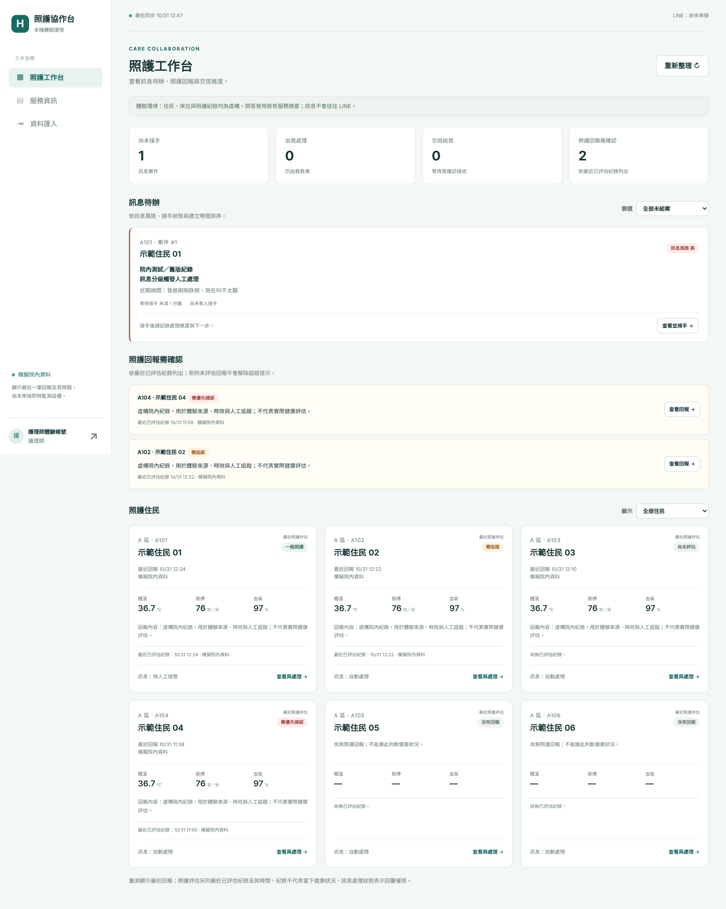

# 一頁看懂 HITLGLOBAL

給第一次看這個專案的人：老師、合作機構、新加入的開發者。細節與歷史紀錄都在 [文件總覽](README.md)，讀這頁不需要先看那些文件。

## 這是什麼

護理之家用的「家屬訊息協作台」。家屬透過 LINE 詢問長輩狀況或長照服務，系統先判斷訊息風險：

- 一般服務問題：用整理好的官方資料自動回覆，並附上來源。
- 需要確認的問題：AI 只能產生草稿，護理師接手、修改、核准後才會送出。
- 緊急警訊（例如跌倒、叫不醒）：不讓 AI 回答，送出固定安全提示，並在協作台建立待接手案件。

護理師在網頁上看到每位住民的卡片：床位、最近照護評估、量測值，以及「這位住民的家屬訊息目前誰在處理」。



## 和市面產品的關係

Jubo、CareOne、uCare 已提供完整的照護紀錄、評鑑與行政系統，Jubo 也有 LINE 家屬入口。本專案不打算重做這些，而是補上家屬訊息進來之後的那一段：

- 誰負責回覆，跨班時如何交接。
- AI 草稿在狀態改變後不能被送出。
- 撤銷家屬授權後，立即停止回覆。

臨床與行政資料仍留在機構原本的系統。這是目前的定位假設，還需要機構訪談確認。

## 和碩士論文的關係

論文〈以 HITL 為核心之 LINE 長照聊天機器人治理框架的探究〉的程式在 `crescent0324/HITL`，已定稿，不在這裡修改。本專案沿用論文的控制原則：

- 規則判定風險，AI 不能自己決定能不能送出。
- 人工處理狀態不會因為下一則一般訊息就自動解除。
- 模型產生完成後，送出前還要再檢查一次權限。

論文的分類器限制（高風險召回率偏低）在這裡同樣存在。本專案的功能測試不構成臨床安全或照護成效的證明。

## 現在能做與還不能做的事

| 已可在本機體驗 | 尚未完成 |
| --- | --- |
| 護理師、接班護理師、護理長、照服員、IT 五種角色，各自只看得到授權範圍 | 真實 LINE 家屬配對與收發（目前為模擬） |
| 家屬訊息分級、轉人工、接手、人工回覆、結案 | 正式帳號、雲端部署、院內系統介接 |
| 指定交班，需接班者確認才轉移責任 | 任何一位真實護理人員的試用 |
| 護理長唯讀監控、撤銷授權後阻擋回覆 | 給藥、傷口、評鑑等完整護理模組（不打算自建） |

## 自己試一次（約 5 分鐘）

Windows、Python 3.12：

```powershell
cd HITLGLOBAL\care_console
python -m venv .venv
.\.venv\Scripts\python.exe -m pip install -r requirements.txt
.\start.cmd
```

1. 瀏覽 `http://127.0.0.1:9465/`，選「護理師」，密碼 `CareDemo2026!`（僅限本機虛構資料）。
2. 點 A101 卡片的「查看與處理」→「服務對話」，對話選「家屬體驗帳號」。
3. 展開「流程測試（本機）」，依序送出「想了解喘息服務」、「轉人工」。
4. 回到首頁，「訊息待辦」出現案件；點「查看並接手」，回覆並結案。
5. 想試交班：接手後指定「接班護理師」，登出後用 nurse2 登入確認接收。

## 下一步

先不加新功能。優先找一到兩家護理之家，請護理長和護理師實際操作，確認「家屬訊息漏接、交班不清」是不是真的問題。訪談與試用材料已在 [UAT 試用套件](uat/README.md)。
