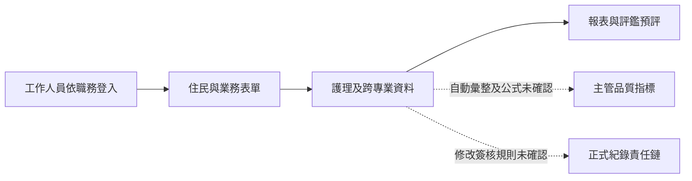

# CareOne 深度研究

研究基準：2026-10-23；查閱：2026-10-24。本輪確認到產品模組與部分歷史操作文字，沒有取得可登入的示範環境或現行完整操作手冊。[來源](SOURCES_AND_EVIDENCE.md) · [逐項矩陣](FUNCTION_MATRIX.md)

## 公司、產品與市場定位

CareOne 官方定位為照護機構專業管理系統，涵蓋護理之家、養護、日照、居護、居服及康復之家等場域。護家版以住民、醫藥、護理、營養、財會及人員管理為主要公開模組；官網強調雲端動態表單與依職務管理住民資料。[C01](SOURCES_AND_EVIDENCE.md#c01)、[C02](SOURCES_AND_EVIDENCE.md#c02)、[C03](SOURCES_AND_EVIDENCE.md#c03)

官網未充分揭露品牌對應法人、成立年、員工規模、活躍客戶數及市場占有率。本研究未用同名海外 CareOne 機構、網站流量估價或第三方技術指紋補足這些資料。簽約前應核對實際供應商法人及責任窗口。

| 商業與導入問題 | 可確認內容 | 仍未確認 |
| --- | --- | --- |
| 商業模式 | 付費服務，另有表單及薪資客製化宣告 | 買斷或訂閱條件、床數／帳號計價、最低費與模組費 |
| 收費 | 官網只以價格親民描述；金額未公開 | 不估算官方報價，也不將首頁約訪活動金額當軟體價格 |
| 部署 | 宣告雲端架構與隨時輸入表單／產生報表 | 雲端地區、正式地端方案、可用性與維運契約 |
| 導入 | 可由官方聯絡管道約訪 | 盤點、轉檔、資料清理、平行作業與上線時程 |
| 教育訓練 | 產品有員工受訓紀錄功能 | 廠商提供的導入訓練課程、頻率、教材及費用；兩者不可混用 |
| 維護 | 有公開服務聯絡方式 | 支援時段、回應／修復時限、更新承諾及服務中斷補償 |
| 客戶案例 | 歷史簡報索引可辨識智創尊榮長照中心情境 | 現行客戶名單、案例授權、合約狀態及獨立成效數據 |

依 C01～C04 與歷史線索 [C05](SOURCES_AND_EVIDENCE.md#c05)整理；沒有聯絡廠商或提出報價申請。

## 研究範圍內的完整模組盤點

| 模組 | 護家版公開功能 | 深度與版本限制 |
| --- | --- | --- |
| 住民作業 | 基本資料、入出院及統計 | 轉床、退住後封存、住民唯一識別及查詢欄位未公開 |
| 護理照護 | 護理紀錄、計畫、健檢及統計 | 修改更正、簽章、評估排程與照會閉環未全公開 |
| 醫藥服務 | 就醫回診、疾病診斷、藥品及處方箋 | 處方變更、逐次給藥、條碼核對、漏給追蹤未知 |
| 工作人員 | 專業排班、教育訓練、考核及統計 | 出勤、證照期限、班別交接與法定人力比規則未知 |
| 營養餐食 | 營養評估、測量與體重曲線 | 餐別、禁忌、吞嚥質地、供餐核對與成本算法未知 |
| 總務財會 | 財產、耗材、出納會計及客製薪資表單 | 盤點、請購審批、住民帳單及正式會計結帳細節未知 |
| 社工服務 | 日照段落明列社會工作；歷史簡報列社工服務及表單 | 護家現版的社工模組、會談、活動與個別化計畫範圍仍未確認 |
| 評鑑與報表 | 客製表單／列印、彙整預評；護家宣告可與中衛上傳資料 | 最新年度適配、上傳欄位與成功／退件狀態未知 |
| 共用平台 | 語音輸入、動態表單、職務群組與住民資料範圍 | API、匯出格式、逐欄權限、簽核與操作稽核未知 |

前六項依 [C01](SOURCES_AND_EVIDENCE.md#c01)護家區塊；共用功能與評鑑依 [C02](SOURCES_AND_EVIDENCE.md#c02)；社工的現版與歷史證據分開處理。NANDA 中文授權在官網仍寫 2015～2017，不能據此宣稱已取得最新版本授權。

## 護理師流程：能還原到哪一步

下表是研究者依公開模組重建的工作情境，實際選單層級、欄位、保存及簽核均須以現版 Demo 補證。它不是廠商操作手冊。

| 工作 | 使用者 → 頁面 → 輸入 | 系統 → 確認 → 追蹤 | 判定及待補證據 |
| --- | --- | --- | --- |
| 登入與每日工作台 | 護理師情境；官網有登入入口，群組可依職務設定 | 登入後工作台與當日待辦未公開 | 登入存在；每日工作台公開資料不足 |
| 交接班與接收 | 交班頁及班別輸入方式未公開 | 已讀、指定接班者、責任轉移及未交接追蹤未知 | 不能由「完整護理紀錄」推定支援 |
| 住民查詢 | 住民作業管理處理基本資料與入出院 | 可形成住民資料與統計；床位及完整照護時間軸未知 | 模組已確認，點按順序未確認 |
| 新增護理紀錄 | 護理照護模組，文字可使用語音辨識 | 有紀錄及報表宣告；保存、必填與補登標示未知 | C01、C02 |
| 修改與簽核 | 公開資料沒有完整更正及簽核教材 | 原文保留、重開、簽章、退件與修改歷程未知 | 不假設一般表單可修改即符合護理更正要求 |
| 生命徵象輸入 | 另有生理資訊與量測服務 | 護家資料能否自動回填、人工核對及錯配更正未知 | 生理服務已確認，與護家一體化為部分支援 |
| 歷史趨勢 | 營養模組明示體重變化曲線 | 全項生命徵象趨勢、異常閾值及個別化條件未知 | 體重曲線不擴張成所有生理數據 |
| 入住與定期評估 | 入出院、護理計畫及日照定期評估各有描述 | 護家全套入住／定期評估、到期提醒未知 | 跨場域不直接移用 |
| 問題、計畫、措施與評值 | 護理計畫與 NANDA 授權宣告存在 | 現版診斷分類、問題與措施連動、評值到期未知 | 授權年份與當前功能須核對 |
| 跌倒、壓傷與感染 | 歷史簡報索引含跌倒及壓瘡品質統計 | 現版事件建檔、分級、通報及結案未知 | 歷史指標不等於現版事件管理 |
| 傷口與管路 | 官網沒有足夠產品特定操作說明 | 位置、照片、分級、換藥／換管與提醒未知 | 保留公開資料不足 |
| 給藥與處置 | 醫藥模組有藥品及處方；歷史索引有給藥表 | 逐次給藥、條碼、醫囑轉處置與未執行原因未知 | 處方管理與給藥執行分開 |
| 跨專業照會 | 護理、醫藥及營養模組分別公開 | 照會收件、接受、回覆及後續追蹤未知 | 多模組不能直接證實照會工作流 |
| 逾期工作與提醒 | 評鑑預評可彙整表單 | 平日逾期清單、責任人及升級提醒未知 | 預評功能不等於主動工作通知 |
| 手機與平板 | 雲端可操作；居服另有行動打卡描述 | 護理端手機版、離線暫存、同步與多人衝突未知 | 不從雲端架構推定所有行動能力 |

各列依 C01、C02、C05；細分狀態見矩陣 N01～N30。未知操作不填入想像中的按鈕或頁面。

## 歷史操作文字的參考價值

CEPAR 託管的 40 頁公開簡報仍能透過搜尋索引讀到部分文字。索引描述住民表單可先選分類與表單，再使用新增、列表及報表；報表可依住民、年度和評估範圍輸出。第 26 頁文字提及選年月、計算區間值與輸出品質報表。[C05](SOURCES_AND_EVIDENCE.md#c05)

這份簡報含 2017 年資料及 2015～2017 授權資訊，搜尋引擎的近期抓取／發布標籤不能用來認定簡報是新版。目前原網址在瀏覽器顯示找不到頁面，直接取得回傳 403，PDF 截圖工具也無法命中快取。因此只登錄頁名、頁次及索引文字，沒有聲稱看見或保存了原始操作畫面。

對 HITLGLOBAL 可借鏡的是「先選住民—再選業務分類—新增紀錄—列表—報表」這種資料入口結構，以及統計需能回查區間與來源的需求。這是研究者對歷史資料的設計解讀，不是現行使用便利性的證明。

## 照服員、護理長及管理者

| 角色情境 | 已公開能力 | 尚未能確認 |
| --- | --- | --- |
| 住宿照服員 | 可依職務群組存取住民資料；日常照護紀錄屬產品範圍 | 每日清單、回報欄位、異常通報、護理師接收及可見資料範圍 |
| 居服員 | 查班、打卡、服務電子簽名等在居服頁宣告 | 與住宿照服員是否同 App、同權限或同操作程序 |
| 護理長 | 排班、人員紀錄、護理統計及評鑑預評有功能宣告 | 缺漏清單、臨床事件趨勢、完成率、覆核與分派流程 |
| 管理者 | 財產、耗材、薪資、財會與住民統計 | 前線紀錄如何成為成本、品質、工作負荷指標，及重算／鎖定規則 |
| IT／權限管理 | 職務與住民群組的權限設定 | 帳號停權、現有工作階段撤銷、IT 與護理長的職責隔離 |

這些角色是研究情境；官方未公開完整的預設角色矩陣。尤其「護理長如何從第一線紀錄取得品質指標」目前只能確認模組與歷史品質報表線索，無法證實現版自動彙整的欄位及計算規則。

## 家屬與 LINE

本輪未找到足以證實護家版提供家屬帳號、住民關係驗證、家屬 App／LINE 入口、家庭聯絡簿、通知、多家屬授權、AI 自動回覆、轉人工、跨班案件或授權撤銷的產品特定資料。這些在矩陣列為公開資料不足，沒有判定不支援。

官網的聯絡管道是對供應商諮詢的入口，不能充作機構與家屬通訊功能證據。即使機構以另外的 LINE 官方帳號提供服務，也必須取得可識別 CareOne 介接的公開資料後才能歸入此產品。[C01](SOURCES_AND_EVIDENCE.md#c01)、[C04](SOURCES_AND_EVIDENCE.md#c04)

## AI、架構與資安

| 領域 | 已知 | 未知與研究界線 |
| --- | --- | --- |
| AI | 語音辨識輸入有明確宣告 | 模型生成、交班摘要、家屬自動問答、來源引用與人工審閱未確認 |
| 架構 | 雲端動態表單及報表 | 不從官網路徑、標頭、HTML 或頁尾建置碼推定私有後端語言與資料庫 |
| 介接 | 中衛評鑑上傳、生理及定位等服務 | 通用 API、匯入匯出契約、銀行／健保／支審的精確範圍未知 |
| 權限 | 職務／身分及住民群組 | 後端逐次檢查、欄位遮蔽、代理、撤銷時效及管理者責任未知 |
| 稽核與資安 | 未取得足夠產品特定規格 | 不以官網 HTTPS 推定整套產品傳輸／靜態加密、備份、保存、DR 或 ISO 認證 |

依 [C02](SOURCES_AND_EVIDENCE.md#c02)及 [C01](SOURCES_AND_EVIDENCE.md#c01)。同廠商可提供其他服務，不代表已經包含在護理之家合約。

## 優勢、限制與產品決策意義

研究者評估：可客製表單、職務與住民群組，以及護理到財會的人員協作範圍，值得作為 HITLGLOBAL 的需求參照。這些是已公開的產品方向，實際上手速度、資料品質與整合程度沒有可比量測。

最大研究限制是現行 UI、角色預設、照護工作流及資安契約的證據不足。CareOne 的文件缺口不能被寫成 HITLGLOBAL 的獨家優勢；也不能因官網說明簡短，就判定產品較不成熟。下一次 Demo 應優先要求：一位住民的新增／更正／簽核、一次交班、一次品質指標回查、照服員權限與停權，以及完整資料匯出。

## 研究者重建示意

以下為研究者重建示意。實線表示公開模組關係，虛線代表仍需現版操作驗證。

介面與教材索引：C01 六張模組插畫已檢視並排除；UI-C05-H01～H05 為歷史文字索引，原檔不可讀。[UI 目錄](UI_REFERENCE_CATALOG.md)另列取得狀態；[PUBLIC_GAPS.csv](PUBLIC_GAPS.csv)保留每個功能的缺口。

[返回入口](README.md) · [Jubo](JUBO_DEEP_DIVE.md) · [uCare](UCARE_DEEP_DIVE.md) · [技術與資安](TECHNOLOGY_AND_SECURITY.md)
