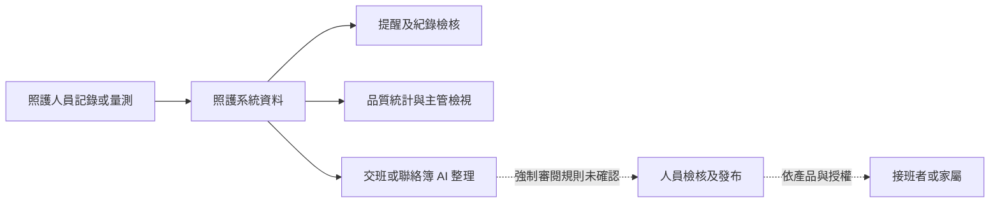

# Jubo 智齡科技深度研究

研究基準：2026-10-23；查閱：2026-10-24。未標發布日的頁面僅能證明查閱日內容，無法完全回溯基準日。[來源登錄](SOURCES_AND_EVIDENCE.md) · [逐項矩陣](FUNCTION_MATRIX.md)

## 產品與公司定位

智齡科技官網記載 2018 年成立，提供住宿、日照、居服三類雲端照護系統，另有 AI 與大型整合專案。這些產品覆蓋的流程不同，研究中保留各場域標籤。「居家照護」在本次主產品頁具體指居服管理，不能直接當成居家護理健保申報系統。[J01](SOURCES_AND_EVIDENCE.md#j01)、[J04](SOURCES_AND_EVIDENCE.md#j04)

公司公布的機構數與資料量屬廠商自述，沒有可比較的活躍機構、客戶留存與市場分母，因此本研究不計算市占或成熟度總分。

| 產品 | 主要使用者及工作 | 邊界 |
| --- | --- | --- |
| 住宿型照護系統 | 護理、照服、社工、營養及管理人員，共用照護與行政資料 | 不將身障機構的年度成果及四年評鑑設定一律當成一般護家流程 |
| 日照型照護系統 | 當日出席、照顧服務、交通、核銷及家屬聯絡 | 安心寶 2.0 的具體證據主要來自此場域 |
| 居服照護系統、i 照護 | 居督、居服員與行政的排班、紀錄、薪資及核銷 | 官方列兩種方案，開通內容須依合約 |
| Jubo AI | 交班、聯絡簿、家訪摘要與文字整理 | AI 能力名稱不代表所有方案自動包含 |
| N-Copilot | A 個管整理派案、錄音、照顧計畫草稿 | 以專案導入，並非單一標準產品 |
| Amy 全人脈絡透鏡 | 居服督導訪視前彙整既有紀錄 | 限 Jubo 居服，另採點數方案 |

產品範圍來源：[J02](SOURCES_AND_EVIDENCE.md#j02)、[J03](SOURCES_AND_EVIDENCE.md#j03)、[J04](SOURCES_AND_EVIDENCE.md#j04)、[J05](SOURCES_AND_EVIDENCE.md#j05)、[J15](SOURCES_AND_EVIDENCE.md#j15)。

## 商業模式、價格與導入

| 項目 | 查閱日公開內容 | 不能據此確定的事項 |
| --- | --- | --- |
| 住宿型價格 | 頁面標示「$125 起（含稅）」；FAQ 說依「立案數」計費，可年繳／月繳，另有一次建置費 | 起價的計價單位、最低用量、附加模組及建置費金額；不自行換算成床月或機構總價 |
| 日照價格 | 「$185／人（含稅）」，依立案數級距調整 | 該區塊未清楚列出計費期間、各級距與全部導入費 |
| 居服方案 | i 照護「$100／人（未稅）」；Jubo 居服「$125／人（含稅）」、至少 10 帳號，均按工作人員計價 | i 照護與 Jubo 的完整功能差異、週期與額外介接費 |
| Amy 點數 | 300 元／20 次、650 元／50 次、1,000 元／100 次；效期一年，依個人帳號購買 | 未以此價格估算全機構 AI 成本；其他 AI 模組報價未公開 |
| 導入 | 需求諮詢、Demo、正式導入；住宿型明示未提供試用 | 舊資料轉檔範圍、平行期、總天數與客戶需投入工時 |
| 訓練維護 | 線上循環課、操作教材、顧問及客戶活動；資源專區有手冊與分段影片 | 客戶系統內教材未登入；夜間人工客服、保證回應時間及支援上限未全公開 |

來源：[J02](SOURCES_AND_EVIDENCE.md#j02)、[J03](SOURCES_AND_EVIDENCE.md#j03)、[J04](SOURCES_AND_EVIDENCE.md#j04)、[J14](SOURCES_AND_EVIDENCE.md#j14)、[J15](SOURCES_AND_EVIDENCE.md#j15)、[J32](SOURCES_AND_EVIDENCE.md#j32)。公開起價與實際機構合約金額分開保存；其餘未公開費用不估作官方報價。

## 已公開模組與資料連動

| 場域／模組 | 可確認內容 | 資料連動與限制 |
| --- | --- | --- |
| 住宿提醒 | 個人化提示、檢測天數、住民與行政提醒 | 提醒可列住民名單；是否每項都可分派、追蹤與結案未知 [J07](SOURCES_AND_EVIDENCE.md#j07) |
| 品質管理 | 收案分類、品質指標、改善片語與照片 | 宣告臨床紀錄轉品質統計；公式、補登重算及分母未公開 [J08](SOURCES_AND_EVIDENCE.md#j08) |
| 紀錄檢核 | 評估與計畫頻率、待評估、受訓時數及聯繫紀錄 | 畫面可見評值與新增評估；不是所有簽章或版本規則的證據 [J09](SOURCES_AND_EVIDENCE.md#j09) |
| 線上簽核 | 多職類路徑、節點時間、意見與進度 | 具行政簽核與審計宣告；AI 發布是否強制經過相同路徑未知 [J10](SOURCES_AND_EVIDENCE.md#j10) |
| 行動交班 | 住民異動、意外與傷口通知、班別及多日紀錄 | 可觀察日期、區域、住民搜尋與交班卡；責任確認規則未知 [J11](SOURCES_AND_EVIDENCE.md#j11) |
| 床邊量測 | VitalLink、推車及相容 IoT 設備 | 選住民、量測、上傳；可暫存量測後恢復同步，非全套護理表單離線 [J12](SOURCES_AND_EVIDENCE.md#j12)、[J16](SOURCES_AND_EVIDENCE.md#j16) |
| 日照執行 | 出席、接送、用餐、沐浴等日常紀錄 | 日常總表可勾選與批次作業 [J27](SOURCES_AND_EVIDENCE.md#j27) |
| 日照營運 | 出席、量測、請假、異常與核銷檢查 | 前線服務紀錄回到儀表及申報檢核 [J19](SOURCES_AND_EVIDENCE.md#j19)、[J26](SOURCES_AND_EVIDENCE.md#j26) |
| 居服執行 | 班表、請假補卡、服務紀錄與特殊回報 | App 與後台班卡、異常、薪資及核銷銜接 [J20](SOURCES_AND_EVIDENCE.md#j20)、[J22](SOURCES_AND_EVIDENCE.md#j22)、[J28](SOURCES_AND_EVIDENCE.md#j28)、[J30](SOURCES_AND_EVIDENCE.md#j30) |
| 居督紀錄 | 家電訪、條件篩選、自訂欄位及選項輸入 | 後續可供 Amy 整理；紀錄審核與責任分配細節未知 [J21](SOURCES_AND_EVIDENCE.md#j21)、[J29](SOURCES_AND_EVIDENCE.md#j29) |
| 特定場域 | 身障教案、年度成果、家訪與評鑑進度 | 分別列為特定模組，不當成一般護家的全部標配 [J17](SOURCES_AND_EVIDENCE.md#j17)、[J23](SOURCES_AND_EVIDENCE.md#j23)、[J24](SOURCES_AND_EVIDENCE.md#j24)、[J25](SOURCES_AND_EVIDENCE.md#j25) |

## 護理師的實際操作證據與流程缺口

下表使用護理師情境。頁名及元件若出自公開畫面即可觀察；未取得操作教材的部分標為重建或未確認，並未登入正式系統。

| 工作 | 進入頁面 → 輸入／選擇 | 系統處理 → 確認／簽核 → 後續追蹤 | 證據與缺口 |
| --- | --- | --- | --- |
| 登入與開班 | 帳號登入後看個人化提示；依類別及提醒天數查住民 | 產生需處理名單；實際完成或解除提醒方式未公開 | J06、J07；登入後第一頁路徑未實測 |
| 交班閱讀 | App 依日期、區域與住民搜尋，閱讀日班／小夜／大夜卡片 | 彙整重點與異常；接班者必須確認或已讀的規則未知 | J11；可見卡片，不推定責任已移轉 |
| 住民查詢 | 名冊選住民，查個人照護紀錄 | 可連到既有紀錄；轉床與住民識別是否分開未知 | J07、J11 |
| 新增護理紀錄 | 教學由醫藥與照護的紀錄功能進入，選區域或住民、記錄時間、輸入或快捷帶入 | 檢查後存檔，在下方列表顯示；可選多人並照會同仁，另選取紀錄列印 | J36，2025 教學含 2024 示例；更正、鎖定與專業簽章仍未知 |
| 修改與簽核 | 檢核畫面有修改／內容／評值；簽核畫面有同意、加簽、備註 | 簽核可留意見與時間；哪些護理文件適用需確認 | J09、J10，不能直接視為電子病歷簽章 |
| 生命徵象 | 手動頁選單人或區域，填觀察時間、數值及疼痛評估；另有 VitalLink 設備量測 | 手動資料暫存、確認時間及完整性後存檔；設備量測可離線暫存後同步 | J37、J12、J16；身分二次核對、錯配更正與重傳規則待查 |
| 歷史及趨勢 | 家屬健康畫面可見歷史表及曲線，日照儀表有量測回顧 | 可回看數據；住宿護理端所有指標的趨勢與標準值設定未知 | J18、J19，場域與角色保留 |
| 入住及定期評估 | 待評估頁可見量表、上次評估與新增／帶入 | 依設定頻率提醒；入住全套量表、簽核及失能評估連動未全確認 | J09 |
| 護理問題、計畫及評值 | 公開說明有照護計畫，畫面有評值入口 | 可追蹤計畫；問題—措施—評值的完整資料鏈未公開 | J02、J09；不推定自動決定護理問題 |
| 跌倒／異常事件 | App 顯示事件通知及時間、事件分類 | 即時推播後閱讀；通報新增、結案、追蹤窗口未公開 | J11 |
| 壓傷／感染 | 一般傷口功能；日照教材清單另列感染、跌倒及體重異常事件 | 住宿感染範圍、壓傷分級、定義、分母及異常處理鏈未知 | J08、J11、J32；日照影片僅核對清單，保留場域限制 |
| 傷口與管路 | 護理系統宣告詞庫、語音、管路與換藥；App 有傷口追蹤 | 後續可看位置與大小紀錄；攝影、分級、換管到期及審核未知 | J02、J11 |
| 用藥與處置 | 智慧交班可整理用藥、外診及特殊處置 | 進入交班重點；逐次給藥核對、條碼與漏給處理未知 | J02；未將摘要當成 eMAR |
| 跨專業照會 | 多人照護紀錄可勾選照會人員；日照及居服另有照會教材 | 可選名單後存檔；照會收件、回覆時限與結案機制未知 | J36、J32；教材標題不等於照會閉環已驗證 |
| 逾期工作 | 依頻率設定檢核，查待評估及未完成紀錄 | 到期提醒及主管檢核；升級通報、代理及責任時限未知 | J09 |
| 行動作業 | 手機、平板與電腦可用；App 看通知與交班 | 量測推車可同步；完整護理表單的離線及多人衝突處理未知 | J11、J16 |

表中來源編號均可由[來源登錄](SOURCES_AND_EVIDENCE.md)查核。已抽查的教學能重建部分步驟；版本、權限及所有例外尚不足以編成現版完整操作手冊。

### 公開教學補查：紀錄、私下交班與行動查閱

官方培訓網站動態載入後，日照有 20、住宿 44、居服 22 筆影音卡片，共 86 筆，對應 85 個不同影片網址。完整清單見 [TRAINING_VIDEO_CATALOG.csv](TRAINING_VIDEO_CATALOG.csv)。本輪優先核對以下三支的完整章節與公開轉錄，並抽看標示畫面；其餘保留「僅確認清單、未播放」。影片在 YouTube 標為不公開搜尋，但官方培訓頁主動公開連結，本輪觀看不需登入或機構代碼。

| 教學與日期 | 已核對的步驟／時間 | 對流程判斷的影響 |
| --- | --- | --- |
| J36 護理紀錄與列印，2025-07-28 | 0:05 新增、0:31 快捷帶入、0:47 私下交班、1:06 多人紀錄、1:54 列印 | 護理紀錄已有公開存檔步驟，應修正只見行銷宣告的判斷；私下註記與正式列印內容有區別 |
| J37 生理數值，2025-07-21 | 0:05 選住民、0:25 表單、0:51 疼痛、1:30 確認存檔 | 手動輸入可直接觀察；試算或前日帶入值的臨床適用性與更正仍需專業確認 |
| J38 智慧照護助理，2025-07-29 | 0:41 登入、0:58 通知設定、2:00 每日彙整、2:34 交班；抽看 2:44 | 使用者可下鑽異常／未量測名單，依日期、區域、住民及班別閱讀；未展示接班接受或責任移轉 |

J36 的私下交班以額外註記呈現，教學說明不列入正式紀錄；不能據此推定刪除、保密或完整稽核政策。J37 輸入畫面含 2024 日期，J38 含 2025 日期，均不保證目前客戶使用同一版介面。[J36](SOURCES_AND_EVIDENCE.md#j36)、[J37](SOURCES_AND_EVIDENCE.md#j37)、[J38](SOURCES_AND_EVIDENCE.md#j38)

## 照服員、護理長與管理者

| 角色情境 | 可確認資訊流 | 權限與管理缺口 |
| --- | --- | --- |
| 住宿照服員 | 床邊選住民與量測，資料回到系統，護理人員看到異常 | 各照服員的住民範圍、可更正欄位、是否能設定護理評估狀態未公開 |
| 日照照服員 | 日常總表勾選出席、接送、沐浴、用餐等，主管看完成狀態 | 批次作業是否有代登、撤回及簽名機制未知 |
| 居服員 | Hi App 顯示今日班表，簽到退、記錄服務及特殊狀況 | 定位允許、離線條件、補卡審批及裝置共享限制未全公開 |
| 護理長 | 從提醒查漏、追蹤評估頻率，讀交班及品質指標 | 不能確認護理長與 IT 是否可預設完全隔離，也未見交班責任鎖的規格 |
| 主管 | 將前線紀錄轉品質收案、指標、改善紀錄及評鑑資料 | 指標分母、更正回算、排除條件與版本追溯未公開 |
| 行政管理 | 排班、出勤、倉儲、請領、費用與收據 | 成本方法、薪資例外、關帳與各表單簽核須 Demo 核對 |

角色工作情境依 J02、J07～J11、J16、J20、J27～J30 整理；角色權限有官方宣告 [J06](SOURCES_AND_EVIDENCE.md#j06)，表中的工作分工仍不等於官方預設權限矩陣。

## 家屬、LINE 與 AI

安心寶 2.0 公開的鏈結是：機構已使用日照系統 → 確認自建或協助建置 LINE 官方帳號 → 提交開通資料 → 串接後家屬重新驗證 → 查詢及互動。家屬可看健康、接送、活動、聯絡簿及帳單；聯絡簿支援回覆與歷史。舊頁的「App」稱法與 2.0 LINE 入口並列，依版本解讀。[J18](SOURCES_AND_EVIDENCE.md#j18)

公開圖可見綁定服務對象、LINE 資料存取授權、聯絡簿勾選及 AI 文字選項。這些畫面不能證實同住民多位家屬的欄位授權、撤銷立即生效、歷史保留範圍或人工案件跨班所有權。[UI 目錄](UI_REFERENCE_CATALOG.md)

| AI 能力 | 資料及操作 | 人工控制與未知 |
| --- | --- | --- |
| 智慧交班 | 照護／外診／用藥／異常資料形成交班重點 | 專業判斷由人主導；強制審閱、接收確認及過時重算規則未知 |
| 家庭聯絡簿 | 機構帶入紀錄，畫面按「AI 生成」可見文字候選 | 可觀察到生成入口；發布前是否必須簽核未知 |
| N-Copilot | 上傳個案資料、音檔，轉錄並生成照顧計畫草稿 | 專案型，沒有公開完整權限、模型版本與草稿失效規格 |
| Amy | 選個案、按生成訪前報告，彙整近三個月服務／電訪／表單；可查原來源 | 依原系統權限，督導判斷；同個案同日沿用結果，新資料對結果有效性的影響未公開 |

依 [J05](SOURCES_AND_EVIDENCE.md#j05)、[J13](SOURCES_AND_EVIDENCE.md#j13)、[J15](SOURCES_AND_EVIDENCE.md#j15)整理。沒有公開證據足以證實「所有家屬問題均由 AI 自動回覆」或 HITLGLOBAL 所採用的風險分級接手狀態機。

## 技術架構、維護與資安

可公開確認的是雲端 SaaS、網頁與選配 App／設備，及廠商宣告的 GCP、Cloudflare、角色權限、加密傳輸、台灣資料存放、每日備份與還原演練。官方另宣告 ISO 27001／27701；最新證書與適用範圍位於客戶系統，本輪未取得。[J06](SOURCES_AND_EVIDENCE.md#j06)

契約終止後的匯出窗口與資安事件通知條件已有公開說明，詳細數字集中於[技術與資安](TECHNOLOGY_AND_SECURITY.md)。資料庫、後端語言、模型供應商、模型版本、外部 API 契約、RTO／RPO 仍未確認。沒有從官網採用的前端技術反推照護產品內部架構。

## 案例、優勢與待確認限制

至傑訪談提到前線量測、發燒通知、後台統整與耗材用量；淨覺案例提到平板及量測資料同步。這些是廠商刊載的具名使用經驗，能支持流程存在的研究線索，未提供控制條件與可重現數據。[J33](SOURCES_AND_EVIDENCE.md#j33)、[J34](SOURCES_AND_EVIDENCE.md#j34)

研究者評估：Jubo 的公開證據最有助於理解「前線紀錄—提醒—主管檢核—家屬資訊」之間的連動，AI 也已進入具體工作情境。其使用便利性、減少錯誤與省時幅度仍須現場測試。公開資料的細緻度不等於產品優劣排名。

最值得補問的內容是：AI 內容發布前的強制審閱、同日新資料如何影響摘要、家屬撤銷與多聯絡人隔離、交班責任轉移、資料離場完整性，以及 API 的合法授權與費用。完整逐列缺口見 [PUBLIC_GAPS.csv](PUBLIC_GAPS.csv)。

## 研究者重建示意

以下為研究者重建示意，整合已公開的功能關係；虛線是尚無操作證據的治理關卡，並非廠商原始流程。

介面索引：UI-J07、UI-J08、UI-J09、UI-J10、UI-J11、UI-J13、UI-J15、UI-J18、UI-J19、UI-J27。詳見 [UI 參考目錄](UI_REFERENCE_CATALOG.md)。

[返回研究入口](README.md) · [CareOne](CAREONE_DEEP_DIVE.md) · [uCare](UCARE_DEEP_DIVE.md) · [產品策略](PRODUCT_STRATEGY.md)
