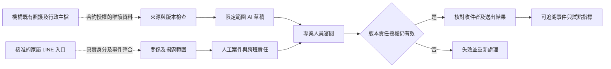

# HITLGLOBAL 產品策略與試點建議

研究基準：2026-10-23；查閱：2026-10-24。本文的優先順序是研究者建議，尚未取得機構付費、工時改善或臨床成效驗證。[功能矩陣](FUNCTION_MATRIX.md)保留事實，[程式差距](HITLGLOBAL_GAP_ANALYSIS.md)保留現版能力與測試界線。

## 決策摘要

建議將 HITLGLOBAL 定位為護理之家既有照護系統旁的「家屬訊息協作與 AI 治理」產品。先驗證家屬資訊揭露、跨班責任與內容有效性，臨床及行政主檔繼續由機構選用的系統管理。這個定位的價值仍需現場研究，不能從競品公開資料缺口推導市場需求。

三家已有照護、行政及評鑑產品範圍；Jubo 已將 AI 用在交班、聯絡簿與訪前整理，uCare 有跨表單、語音及營運整合，CareOne 明列多項護家模組。因此，單純增加表單、語音或 AI 摘要，尚無充分證據構成差異。[J02](SOURCES_AND_EVIDENCE.md#j02)、[J05](SOURCES_AND_EVIDENCE.md#j05)、[J15](SOURCES_AND_EVIDENCE.md#j15)、[C01](SOURCES_AND_EVIDENCE.md#c01)、[C02](SOURCES_AND_EVIDENCE.md#c02)、[U11](SOURCES_AND_EVIDENCE.md#u11)

## 已有證據與尚待驗證的機會

| 主題 | 已有證據 | 產品假設與如何推翻 |
| --- | --- | --- |
| 家屬入口 | Jubo 日照已有 LINE 關係驗證、聯絡簿及回覆；uCare 日照有家屬 App | 若機構既有入口已充分解決收件授權與追蹤，再加一套入口可能增加負擔，應取消或改為整合 |
| 人工責任 | H 本機有案件接手、指定交班、接收後移轉及過時阻擋測試；競品相同時序未公開 | 需要先觀察漏接、重複處理或交班不清是否真有發生；若沒有，獨立案件工具的價值不足 |
| AI 與來源 | Jubo Amy 已提供來源與原權限；H 有來源／設定／內容有效性實作，但驗證不完整 | 可比較的機會在可檢查的失效規則；若競品同題 Demo 已完整覆蓋，不能再主張此點具有相對優勢 |
| 主管監督 | Jubo／uCare 已有品質與管理統計；H 只有訊息待辦及追蹤 | 先驗證訊息責任指標是否能支援主管決策，沒有依據將 H 宣傳成臨床品質平台 |

競品來源：J18、J15、U01、U11；H 的直接證據見 [CODE_EVIDENCE.csv](CODE_EVIDENCE.csv)及 [TEST_EVIDENCE.csv](TEST_EVIDENCE.csv)。目前可實證的是固定程式中的特定控制，沒有已證實的獨家能力或場域競爭優勢。

## MVP 一：真實 LINE 家屬授權與收件核對

對象是核准試點的機構工作人員與自願參與之家屬。目標是讓每次資料揭露都有可核對的住民關係、揭露範圍及實際收件者。現版 CONTACT／REVOKE 的本機隔離與撤銷測試提供起點，真實身分與傳輸仍屬 C 類。[H01](SOURCES_AND_EVIDENCE.md#h01)

建議最小範圍：一個核准的官方帳號、一個機構、少數自願個案，先開固定服務資訊與人工訊息。臨床資料揭露另訂欄位與責任，避免在綁定完成前直接使用敏感內容。這是未來試點設計，本次研究沒有建立或傳送真實家屬資料。

| 必要工作 | 可觀察的驗收條件 | 現版差距 |
| --- | --- | --- |
| 真實關係確認 | 機構可確認誰代表哪位住民、可看哪些資料；不同聯絡人分別授權 | 目前是模擬配對，缺少正式身分程序 |
| 事件與收件者 | 相同 Webhook 重送不重複建案；邏輯對話編號不會被當成 LINE 收件者 | 目前有邏輯對話保護，缺少端到端正式傳輸 |
| 撤銷 | 撤銷後查詢、待審草稿、生成結果及送出前檢查均阻擋受限資訊 | 本機已測部分撤銷，尚缺真實通道與併發驗收 |
| 結果不明 | 將 API 接受、失敗、結果不明及可取得的收件證據分開；重試策略可追蹤 | 尚未完成；不能把 API 成功直接寫成手機已讀 |

建議衡量：錯誤收件者／錯誤揭露測試失敗數、撤銷生效時間分布、重送造成的重複案件數、工作人員處理綁定所需時間。數值目標須由機構風險與實際基線共同決定；此處沒有捏造達標結果。

試點停止或回退條件：錯誤揭露、無法證明關係、撤銷競態失敗或不明傳輸結果導致重複揭露。發生時停用相關揭露能力，保留必要事件以查核；不擴大試點。

## MVP 二：跨班人工案件責任與逾時追蹤

對象是護理師、指定代理與護理長。目標是讓家屬的待辦訊息在跨班時有明確責任，並讓新訊息與過時交班可被辨認。現版 CASE／HANDOFF 已有本機測試；正式值班對應、代理及提醒仍需開發。[H01](SOURCES_AND_EVIDENCE.md#h01)

最小資料是案件、聯絡人、目前責任人、處理進度、下一步、時限與待接收版本。原責任人提出後持續負責，指定接班者讀取最新內容並接受才移轉；中途新訊息或進度變更使舊請求失效。現版測試可支持這些服務案件語意，不能推論已涵蓋整張護理交班單。

| 建議新增 | 驗收情境 | 管理價值假設 |
| --- | --- | --- |
| 當班與代理對應 | 無效／離職／非當班人員不可被默認為可接班者 | 讓責任對應實際人力，而非只存在軟體帳號 |
| 機構定義的時限及升級 | 到期無人接收時，原責任不消失，主管看得到原因與下一個動作 | 減少跨班待辦遺漏；是否有效需觀察 |
| 失敗與重啟保存 | 多人同時接手、重送、斷線及重新啟動後仍只有有效責任人 | 降低重複處理與責任空窗 |
| 護理長查核 | 可區分待接收、已接受、逾期、已結案；回查當時內容版本 | 讓主管能解釋案件停在哪一步 |

建議衡量：無責任人的有效案件數、待接收時間、首次回應與結案時間、重複處理數、交班後重開及工作人員記錄負擔。先量測人工現況，再以相同案件定義比較，不能將訊息速度直接等同照護品質。

停止／調整條件：新增工具使既有 LINE 與 ERP 重複登打、時限配置造成錯誤催辦、代理責任無法落地，或主管無法解讀統計分母。必要時整合到既有工具，而非要求前線同時維護多套待辦。

## MVP 三：照護來源追溯與草稿過時阻擋

對象是具有相應權限的護理人員。先選一種經授權、唯讀、範圍固定的來源；例如已確認的個別服務紀錄匯出，或有合約的查詢 API。現版 IMPORT 只接受虛構量測 CSV，不能直接拿來接正式 ERP；GEN／CONTEXT 是 B 類，需補足直接測試。[H01](SOURCES_AND_EVIDENCE.md#h01)

目標流程：選定允許揭露的來源與有效期間 → 產生標為草稿的內容 → 人員對照來源修改與核准 → 送出前再次核對來源、對話、設定、責任與授權版本。任一相關條件變更，原核准失效，重新產生或重新審閱。

| 驗收面向 | 必須證明的行為 |
| --- | --- |
| 來源可回查 | 每段內容能回到允許取得的紀錄與時間；來源編號合法之外，另查內容是否得到支持 |
| 更新失效 | 資料補登、更正、撤銷、對話新增、模型設定變更或到期時，舊內容不能沿用核准直接送出 |
| 人工責任 | 明確記錄誰看過哪個版本、修改哪些內容；一般登入或看到草稿不算核准 |
| 失敗回退 | 模型逾時、配額不足、空白或無來源支持時，保留可解釋狀態並交人工處理 |
| 揭露與傳輸 | 生成時與送出時各自核對授權；MVP 一未通過前，不擴大真實對外內容 |

建議衡量：來源支持正確率、遺漏重要資訊比例、過時核准攔截率、人工修改量、審閱時間、拒答／轉人工比例。由專業人員定義標準與標註程序，保留誤報及未攔截案例；本輪沒有量測結果。

停止／回退條件：無法合法取得來源、住民身分錯配、人工以為草稿已確認、重要更新未失效或核准責任不清。必要時先採純人工整理與來源查看，繼續收集需求。

## 合法整合的前置資料與責任

本輪找到 Jubo 設備／支審、CareOne 中衛上傳、uCare 政府／銀行／設備等既有介接，沒有可讓 HITLGLOBAL 立即採用的公開第三方 API 契約。因此，下表是整合需求清單，並非宣稱廠商已開放這些端點。[J12](SOURCES_AND_EVIDENCE.md#j12)、[J26](SOURCES_AND_EVIDENCE.md#j26)、[C01](SOURCES_AND_EVIDENCE.md#c01)、[U11](SOURCES_AND_EVIDENCE.md#u11)

| 層次 | 上線前需具體確認 |
| --- | --- |
| 權利及資料角色 | 機構、廠商與 H 各自處理目的、範圍、委外條件、分包、AI 資料流及終止後取回／刪除 |
| 使用方式 | 書面開放的 API 或機構合法匯出；取得測試環境、限額、費用及版本維護責任 |
| 識別及語意 | 住民唯一碼與床位分開；來源紀錄碼、單位、缺值、觀察時間、更新時間與時區明確 |
| 更新及一致性 | 補登、更正、撤回、去重、同步游標、斷線、重送與版本失效規則 |
| 權限及稽核 | 職務、住民與欄位權限；關係撤銷傳播；誰看了、改了、核准或送出了哪個版本 |
| 維運及離場 | 告警、備份還原、RTO／RPO、資安通報、故障責任、資料匯出格式與驗收 |

初期建議唯讀匯入並保留來源連結，正式回寫另做欄位與錯誤復原驗收。畫面爬取、共用機構帳密或繞過登入均不屬本研究提出的整合方案。相關法規控制的適用範圍見[技術與資安](TECHNOLOGY_AND_SECURITY.md)，仍需按機構設立類型及實際契約判定。

## 試點順序、採購與需求驗證

建議依序完成：與機構釐清實際案件及既有流程 → 用虛構資料演示失敗情境 → 確認資料及維運責任 → 小範圍影子模式觀察 → 自願個案試點 → 檢查前線負擔與指標 → 決定擴大、整合或停止。這是未來工作建議，本次未聯絡廠商、機構或家屬。

費用研究僅可使用 Jubo 公開起價與點數，CareOne／uCare 仍需正式報價。三家總持有成本應分建置、歷史轉檔、帳號／床數／人數、設備、AI、介接、教育、維護及離場，沒有資料的欄位標未公開。不能把 Jubo 的局部起價乘床數就當作跨產品採購比較。

## 與原 HITL 論文的邊界

人工審閱、風險規則、來源有效性、訊息隔離及接手時序與原研究主題相連；真實家屬身分、臨床資料與現場試點新增不同研究條件。應另訂資料、倫理及場域評估，固定原研究成果。[H01](SOURCES_AND_EVIDENCE.md#h01)

完整 ERP 的人資薪資、會計、庫存、營養餐食、健保申報與專業量表重建，現階段會擴大產品及研究範圍。若後續確有需求，另立專案與資源估算，不把完成大量表單當成已驗證治理研究的替代品。

## 研究者重建示意：建議試點架構

此圖是未來設計建議；虛線表示尚需授權、介接或驗收，非現版已部署架構。

[返回入口](README.md) · [程式差距](HITLGLOBAL_GAP_ANALYSIS.md) · [工作流程](WORKFLOW_COMPARISON.md) · [資料缺口](PUBLIC_GAPS.csv)
