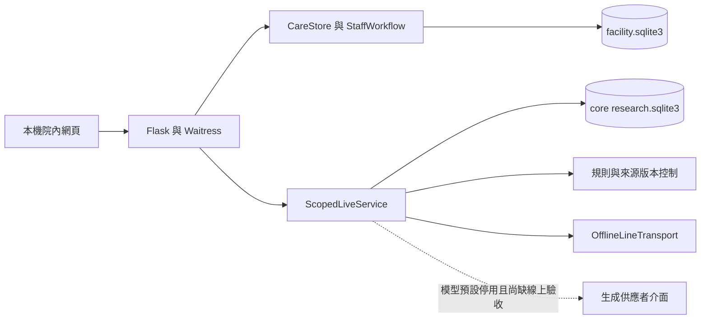

# 技術架構、AI、權限與資安比較

查閱：2026-10-24；研究基準：2026-10-23。廠商宣告、可觀察介面與實測結果分開。沒有取得私有後端程式、資料庫或機構資料，未從官網前端推測產品內部技術。[證據登錄](SOURCES_AND_EVIDENCE.md)

## 公開架構與介接能力

| 面向 | Jubo | CareOne | uCare | HITLGLOBAL |
| --- | --- | --- | --- | --- |
| 部署 | 雲端 SaaS、網頁、App／設備 [J01](SOURCES_AND_EVIDENCE.md#j01) | 雲端表單與報表 [C02](SOURCES_AND_EVIDENCE.md#c02) | SaaS [U11](SOURCES_AND_EVIDENCE.md#u11) | 本機 Flask／Waitress；只綁定 127.0.0.1，拒絕外部 Host／IP |
| 基礎環境 | 廠商明示 GCP 與 Cloudflare [J06](SOURCES_AND_EVIDENCE.md#j06) | 主機與後端未公開 | 現行主機未公開；2022 文件曾明述網頁三層式架構 [U15](SOURCES_AND_EVIDENCE.md#u15) | Python、SQLite、原生 HTML／CSS／JavaScript，可由固定程式確認 |
| 私有資料庫及語言 | 未確認 | 未確認 | 未確認 | SQLite 兩個資料庫；不等於已具高可用或多機構部署 |
| 手機與平板 | 多種 App／LINE／網頁；量測可暫存 [J11](SOURCES_AND_EVIDENCE.md#j11)、[J16](SOURCES_AND_EVIDENCE.md#j16) | 雲端不等於全功能手機版；護家行動介面未確認 | 居服 App、日照平板有公開圖 [U01](SOURCES_AND_EVIDENCE.md#u01)、[U13](SOURCES_AND_EVIDENCE.md#u13) | 網頁；本輪未執行手機／平板驗收 |
| 既有介接 | IoT、支審、專案整合 [J12](SOURCES_AND_EVIDENCE.md#j12)、[J26](SOURCES_AND_EVIDENCE.md#j26)、[J30](SOURCES_AND_EVIDENCE.md#j30) | 中衛評鑑及生理資訊服務，精確整合範圍待確認 [C01](SOURCES_AND_EVIDENCE.md#c01) | 依場域有全人評估、健保、照管／支審、銀行、設備 [U11](SOURCES_AND_EVIDENCE.md#u11) | 虛構量測 CSV；真實 ERP 與設備介接待做 |
| 公開開發者 API | 未取得可直接採用的契約 | 未取得 | 未取得 | 內部院內 API 可讀，不是正式第三方契約 |
| FHIR／HL7 | 產品特定規格未確認 | 未確認 | 未確認；外部場域頁連到長照實作指引不等於 uCare 已合規 | 固定版本沒有 FHIR 連接器 |
| 匯出／離場 | 官方有合約終止後匯出說明 [J06](SOURCES_AND_EVIDENCE.md#j06) | 報表列印有宣告，完整資料匯出未知 | 網站政策不能取代機構 ERP 資料離場規格 | SQLite 備份；缺標準跨系統完整匯出 |

HITLGLOBAL 依 [H01](SOURCES_AND_EVIDENCE.md#h01)及[程式核對組](HITLGLOBAL_GAP_ANALYSIS.md#程式與測試核對組)；底層 `LineTransport`／模型類別存在，不能據此宣稱已接通現行照護協作台。

## AI 能力獨立比較

| 問題 | Jubo | CareOne | uCare | HITLGLOBAL |
| --- | --- | --- | --- | --- |
| 已知 AI 類型 | 交班、聯絡簿、家訪摘要；N-Copilot 與 Amy | 語音辨識明示；生成式功能未確認 | uCare 的 AI 語音紀錄；其他四大方案分產品 | 規則風險、受限來源生成核心與離線替代服務 |
| 輸入資料 | 照護、量測、交班、家屬及訪視；依應用不同 | 語音文字，其他資料未確認 | 跨專業紀錄與語音，精確欄位未公開 | 固定服務資料卡、同聯絡人受限歷史；未將臨床看板自動交給模型 |
| 摘要／生成 | 有明確工作情境 | 未確認 | 語音不直接證明自動交班、家屬摘要或計畫生成 | 尚無臨床交班摘要；固定服務摘要與模型生成分開 |
| 查詢／異常 | Jubo AI 宣告資料查詢；生理異常另有產品機制 | 生理服務不直接證明 AI 對話風險 | 量測方案有 AI 提醒；是否 uCare 標配需核對 | 規則決定風險與範圍，不由模型更改人工狀態 |
| 模型供應商與版本 | 現行未確認 | 未確認 | 未確認 | 可讀 API 供應商類別與設定欄；本輪無線上模型驗收，不指定單一已部署模型 |
| 訓練及資料授權 | 累積資料量不證明全部拿去訓練；未取得逐資料授權 | 未確認 | 未確認 | 原研究與正式機構資料使用分開，尚無正式機構訓練資料流程 |
| 來源追溯 | Amy 明示來源及既有權限；一般 AI 宣告可檢核 | 未確認 | 生成逐句來源未確認 | 保存來源 ID、知識／提示版本及雜湊；不保證逐句真實 |
| 人工最終責任 | 明示專業人員主導 | 未確認 AI 特定流程 | 未公開足夠 AI 審閱規格 | 人工接手與草稿審閱程式可讀；部分情境未充分測試 |

依 [J05](SOURCES_AND_EVIDENCE.md#j05)、[J15](SOURCES_AND_EVIDENCE.md#j15)、[C02](SOURCES_AND_EVIDENCE.md#c02)、[U09](SOURCES_AND_EVIDENCE.md#u09)、[U11](SOURCES_AND_EVIDENCE.md#u11)及 H01。沒有把 AI 行銷用語視為端到端安全保證。

## 人工審核與狀態控制獨立比較

| 控制 | Jubo | CareOne | uCare | HITLGLOBAL 目前證據 |
| --- | --- | --- | --- | --- |
| 行政／紀錄簽核 | 多職類路徑與節點時間已宣告 J10 | 特定簽核流程未確認 | 圖有表單區，完整規格未公開 | 沒有完整護理紀錄簽核模組 |
| AI 發布前強制審閱 | 「人員主導」已明示；強制關卡未知 | 未確認 | 未確認 | 中風險草稿 API／核心存在，分類 B |
| 人工接手持續有效 | 與 H 相同狀態語意未確認 | 未確認 | 未確認 | 同對話新低風險訊息不解鎖，分類 A |
| 接班者確認才移轉責任 | 未取得精確規格 | 未取得 | 未取得 | 指定接班者、版本與新訊息檢查，分類 A |
| 授權撤銷擋住舊生成 | 家屬撤銷時序未知 | 未確認 | 未確認 | 已測生成期間撤銷及重新授權不復活舊工作，分類 A |
| 新內容／設定使草稿失效 | Amy 同日沿用結果，新資料規則未知 | 未確認 | 開發 Git 版本控制不等於執行期草稿控制 | 程式有取消與版本核對，完整覆蓋仍為 B |
| 傳輸狀態與手機收件區分 | 產品精確狀態未公開 | 未公開 | 未公開 | 有傳輸狀態核心，但協作台只允許模擬，真實收件未驗收 |

這是公開可比的控制語意，沒有將未知格描述為競品缺乏。U11 對開發 Git 的說明，只涉及程式版本，沒有用來證明對話或草稿在執行期間的有效性。

## 角色權限獨立比較

| 權限層次 | Jubo | CareOne | uCare | HITLGLOBAL |
| --- | --- | --- | --- | --- |
| 職務及資料範圍 | 自訂角色可見資料 J06 | 職務／身分群組與住民資料 C02 | 帳號、驗證、分級 U11 | nurse／admin 全部體驗住民，caregiver 指定範圍 |
| 專業評估權 | 預設逐欄規格未知 | 未知 | 未知 | 後端拒絕照服員設定已評估狀態 |
| 家屬關係 | 安心寶重新驗證及綁定已明示 J18 | 未確認 | 日照 App 存在，精確關係驗證未知 | 只有本機模擬配對 |
| 多家屬隔離 | 內部規格未知 | 未知 | 未知 | 同住民不同聯絡人訊息、案件及生成隔離，已測 |
| 護理長與 IT | 可設角色不等於預設隔離 | 未公開 | 未公開 | admin 合併，分離為規劃 C |
| 撤銷與既有工作階段 | 詳細時序未公開 | 未公開 | 未公開 | 後端每次重查；相應測試通過 |

## 資安、保存與復原

| 項目 | Jubo | CareOne | uCare | HITLGLOBAL |
| --- | --- | --- | --- | --- |
| ISO | 官方宣告 27001／27701；最新證書範圍需客戶入口 | 未確認 | 2013 版歷史資訊與 2022／27701 標準敘述並存；證書未核驗 | 未取得認證的公開證據 |
| 傳輸 | 官方宣告全程加密 | 產品特定規格未知 | U11 宣告加密，U13 居服 App 商店寫未加密 | localhost HTTP；正式 HTTPS 待做 |
| 靜態加密 | 精確範圍／金鑰管理未公開 | 未公開 | 未公開 | SQLite 未加密，不因密碼雜湊而視為資料庫已加密 |
| 登入保護 | 密碼規則及失敗鎖定可由機構配置 | 詳情未知 | 驗證與監測宣告；MFA 等未知 | 本機密碼、CSRF、同源、速率限制；不是正式企業身分方案 |
| 稽核 | 宣告每筆操作可追到個人；簽核節點有時間意見 | 未取得明確產品規格 | 操作紀錄與異常監測宣告 | SQLite 事件與操作者；未達不可竄改 |
| 備份 | 每日至少一次，定期還原演練，廠商宣稱 | 未公開 | 備份機制宣告，頻率與演練未知 | 手動快照及新目錄還原測試 |
| 資料位置 | 宣告資料與主機在台灣 | 未公開 | 未取得產品特定承諾 | 只有本機儲存；檔案路徑不能證明地理位置，正式託管及 AI 出境未確認 |
| 離場資料 | 終止後三個月內可自行免費匯出；之後可識別資料刪除，延長另約 | 未公開 | 網站帳號政策與 ERP 紀錄契約未釐清 | 未有正式保存、離場與刪除生命週期 |
| 事件通報 | 頁面寫八小時相互通報，工作日二十四小時內修復或暫行方案 | 未公開 | 有分級修復及 SLA 宣告，數值未知 | 常駐監控及責任通知尚未完成 |
| 可用率／RTO／RPO | 未公開足夠量化承諾 | 未公開 | 未公開數值；不能因有 SLA 字樣填上百分比 | 未訂並未驗收 |

Jubo 本表數字依 [J06](SOURCES_AND_EVIDENCE.md#j06)廠商公開條件，正式採購仍應核對機構簽署的合約版本。CareOne 以 C01／C02 的公開界線判定；uCare 依 [U01](SOURCES_AND_EVIDENCE.md#u01)、[U07](SOURCES_AND_EVIDENCE.md#u07)、[U11](SOURCES_AND_EVIDENCE.md#u11)、[U12](SOURCES_AND_EVIDENCE.md#u12)、[U13](SOURCES_AND_EVIDENCE.md#u13)。

U13 的「無法刪除資料」與 U12 的客服申請刪除不可直接相互抵銷。應釐清 App 內操作、網站帳號、ERP 個案紀錄、法定保存與備份中的資料各自如何處理。U12 的 3,600 秒暫存清除也不是照護紀錄保存期限。

## 台灣制度與採購控制對照

先確認機構是依護理人員法設立的護理機構，或長服法下的住宿式長照機構，再選適用辦法。G03 的逾 200 床加強措施有特定適用範圍，不可拿來推論小型護理之家沒有基本控制要求。

| 依據 | 與系統研究直接相關的要求／議題 | 應取得的可查核資料（研究者建議） |
| --- | --- | --- |
| 個資法第 3、5、6 條 [G01](SOURCES_AND_EVIDENCE.md#g01) | 當事人權利、必要範圍及病歷／醫療／健康檢查等特種個資 | 資料目的、使用依據、家屬揭露權限、同意與撤銷、AI 使用範圍 |
| 護理機構安維辦法 [G02](SOURCES_AND_EVIDENCE.md#g02) | 計畫、身分、隱碼、傳輸保護、權限與監控 | 帳號清冊、角色矩陣、操作與查閱紀錄、異常處理、演練及資料處理約定 |
| 私立長照機構安維辦法 [G03](SOURCES_AND_EVIDENCE.md#g03) | 適用定義、專責與查核人員、安維計畫及安全措施 | 設立類型、床數、職責分工、軌跡及證據保存、業務終止處理 |
| 115 年護家評鑑 [G04](SOURCES_AND_EVIDENCE.md#g04)、[G05](SOURCES_AND_EVIDENCE.md#g05) | 當年度評鑑與佐證、實地訪查及操作情境 | 逐點資料對照、可回查的前線紀錄、更新日期及現場流程證據 |

G01 頁面明載 114-11-11 修正中有尚未施行條文，因此本研究沒有直接引用新版刪除第 27 條作為現行控制義務已消失的結論。系統宣告通過 ISO、提供評鑑報表或採用 LINE，均不足以自行認定整套機構法遵已完成。

## HITLGLOBAL 已核實架構示意

以下為研究者依固定版本程式重建的示意；只描述目前主應用，沒有把競品私有架構填入圖中。

依 `app.py`、`run.py`、`conversations.py`、`research.py`，連結見[程式核對組](HITLGLOBAL_GAP_ANALYSIS.md#程式與測試核對組)。本機鎖、SQLite 交易及已有測試不能擴張成分散式安全保證。

[返回入口](README.md) · [工作流程](WORKFLOW_COMPARISON.md) · [產品策略](PRODUCT_STRATEGY.md)
