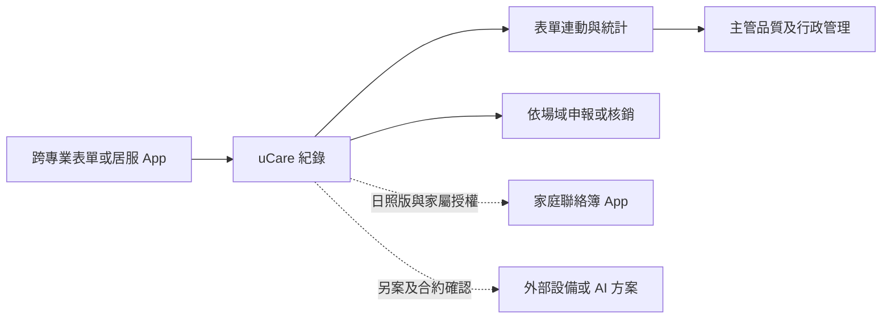

# uCare／諾亞克深度研究

研究基準：2026-10-23；查閱：2026-10-24。以具名 uCare 證據為主，所有無日期頁面保留無法回溯基準日的限制。[來源](SOURCES_AND_EVIDENCE.md) · [功能矩陣](FUNCTION_MATRIX.md)

## 公司、產品定位與歷史

諾亞克官網記載 2012 年成立，2014 年推出住宿型 uCare，後續增加居護、居服與日照版本。產品定位是跨場域的電子照護紀錄與機構營運管理。官方成功案例列出醫院、護理之家、長照集團、日照與居家單位，但名單不證明每個客戶目前仍使用全部模組。[U07](SOURCES_AND_EVIDENCE.md#u07)、[U08](SOURCES_AND_EVIDENCE.md#u08)

## 先分清楚 uCare、TLCA 與其他方案

| 公開名稱 | 可以歸入的研究範圍 | 不應移用的內容 |
| --- | --- | --- |
| uCare 長照資訊系統 | 住宿型跨專業電子紀錄；U11 明指的營運與介接功能 | 不把旁邊 TLCA 的入住評估工時成本宣稱移入 |
| uCare 居家護理 | 個案、醫令及健保相關作業 | 不當成住宿型護家每個帳號都有健保讀卡 |
| uCare 居家服務 | 居服派班、服務執行與核銷；居服 App 明確隸屬此產品 | 不把居服打卡當成住宿護理師的完整排班 |
| uCare 日間照顧 | 家屬聯絡簿 App、日照紀錄及 IoT 整合 | 不推定住宿家屬入口與日照完全相同 |
| TLCA 住宿／居服／日照 | 官方另列的產品線 | 其工時計算、家屬關懷與人臉自動簽到不能自動列為 uCare 標配 |
| 智能管家電子白板、生理量測儀、門禁 | 可選整合產品，須核對實際方案 | 不是所有 uCare 客戶都已裝設的證據 |
| 視覺化報表、托育 App、派車與電商 | 公司其他產品 | 托育即時聊天、客製戰情中心不自動算 uCare 功能 |
| OIC、AIDC、EVA、非接觸量測 | 公司 AI 解決方案，可單獨或組合導入 | 不將其儀表或展示百分比當成 uCare 內建或實測效益 |

依 [U01](SOURCES_AND_EVIDENCE.md#u01)、[U09](SOURCES_AND_EVIDENCE.md#u09)、[U11](SOURCES_AND_EVIDENCE.md#u11)分界。2025-04-02 的「3.0 即將推出」屬升級預告，不能直接證明所有客戶已完成 CRM／AI 升級。[U10](SOURCES_AND_EVIDENCE.md#u10)

## 商業模式、導入、教育訓練與維護

| 項目 | 可確認 | 仍需取得 |
| --- | --- | --- |
| 模式 | 雲端軟體服務（SaaS）、模組化與客製擴充 | 訂閱單位、最低年期、建置／移轉／介接與選配費 |
| 價格 | 金額未公開 | 不以公司耗材營收、採購資格或同業價格估算 uCare 報價 |
| 導入程序 | U11 記載資料盤點、環境建置、匯入、教育訓練及客服群組 | 各階段輸入、責任、天數、資料驗收與離場條件 |
| 訓練 | 長照專員與工程團隊協助；App 及場域流程有公開介紹 | 各角色現版操作手冊、課程與複訓條件 |
| 維護 | U11 宣告電話、線上客服、技術支援及 SLA | 具體可用率、回應與修復時限、假日支援及補償條件 |
| 擴充 | 宣告可依機構及縣市調整表單與報表 | 客製後更版相容、資料格式、驗收成本與第三方使用 API 的權利 |

上述多屬品質標章平台刊載的產品方說明 [U11](SOURCES_AND_EVIDENCE.md#u11)，不是本研究執行的導入觀察或服務水準測試。

## uCare 各場域模組

| 場域／層次 | 具體公開能力 | 證據強度與缺口 |
| --- | --- | --- |
| 住宿照護 | 多專業評估、重複帶入（DITTO）、連續表單、帶入護理紀錄 | U00 與 2022 年 U15 有具體描述，U11 支持跨表單整合；現版完整表單及簽核未知 |
| 住宿管理 | 人事薪資、財務、進銷存及品質指標自動統計 | U11 明指 uCare；指標定義、分母、資料更正與稽核須補證 |
| 住宿工作台 | 住民人數、異常事件、待簽／逾時表單等資訊區塊 | 官方產品圖可觀察，示例為 2021 年；不當成已操作現版 |
| 居家護理 | 個案與醫令、健保讀卡申報；表單連動與統計 | U11、U15；訪視、醫令、申報退件的完整流程未知 |
| 居家服務 | 班表、打卡、服務項目、申報與行政報表 | U13 開發者與 U14 使用機構均描述前線執行順序 |
| 日照 | 家屬聯絡簿 App、服務計畫、量測及人事打卡等整合 | 依 U01、U11、U15；家庭授權與撤銷細節未知 |
| 共用介接 | 全人評估、照管／支審、銀行及設備 | 場域適用不同；沒有公開的 HITLGLOBAL 第三方 API 使用契約 |
| AI | uCare 名下宣告 AI 語音照護紀錄 | U11；其他 AI 方案及外部語音產品不能都算原生 uCare |

來源：[U00](SOURCES_AND_EVIDENCE.md#u00)、[U01](SOURCES_AND_EVIDENCE.md#u01)、[U11](SOURCES_AND_EVIDENCE.md#u11)、[U13](SOURCES_AND_EVIDENCE.md#u13)、[U14](SOURCES_AND_EVIDENCE.md#u14)、[U15](SOURCES_AND_EVIDENCE.md#u15)。

## 護理師操作與資料流

下表把護理師的研究情境與公開可見元件分開。未看到的頁面、按鈕及簽核流程不補成事實。

| 工作 | 頁面 → 輸入或選擇 | 系統處理 → 確認／追蹤 | 已知與未確認 |
| --- | --- | --- | --- |
| 登入與開班 | 帳號登入有 U11 宣告；住宿產品圖有模組列與異常區 | 可從人數、事件及表單區看待辦 | 2021 圖示例；2026 預設首頁、待辦排序與已讀未知 |
| 交接班 | uCare 產品特定交班頁、班別選擇未公開 | 指定接班者、確認責任與新訊息衝突規則未知 | 不把外部電子白板提醒當成責任交接 |
| 住民與床位 | 住宿圖有住民／床位欄位與在院人數 | 可觀察住民資料入口；轉床及沿革未知 | 僅能確認部分介面資訊 |
| 新增紀錄 | 依 U00／U15 的表單描述，選專業表單填寫或帶入 | 資料可連動護理紀錄及統計 | 正式儲存、撤回與簽章元件未公開 |
| 修改及簽核 | 公開圖有表單區，U11 宣告操作紀錄 | 哪些表單需簽核、誰能更正及如何留前版未知 | 不能由表單入口推論完成電子簽章 |
| 生命徵象 | 公開宣告設備與系統連動，另可選智慧量測方案 | 可上傳與個人化警示；人工輸入、身分核對及重複資料處理未知 | U01、U11；設備與方案需個別核對 |
| 歷史趨勢 | 日照圖可見評估量表曲線 | 不足以證實全項生命徵象趨勢 | ADL 曲線不當成血壓等生理曲線 |
| 入住及定期評估 | 多專業評估、DITTO 與連續表單設定 | 已有評估資料連動方向；入住必填及定期到期規則未知 | U00、U15 為歷史與場域描述 |
| 問題與照護計畫 | 公司有 NANDA 授權宣告，服務計畫可匯入 | 各版護理診斷、措施、評值的狀態與關聯未知 | 不能把服務計畫匯入當完整護理計畫管理 |
| 跌倒、壓傷、感染 | 住宿圖有異常事件區；U11 有品質統計 | 事件分級、通報、感染定義與追蹤閉環未知 | 指標總稱不能填補事件模組細節 |
| 傷口與管路 | 專業電子表單可確認，特定表單未公開 | 傷口照片、管路到期、換藥換管及評值未知 | 保留公開資料不足 |
| 給藥與處置 | 圖有醫療／藥品等入口，居護歷史說明有醫令 | 逐次給藥、處置核對及未執行原因未知 | 跨版醫令功能不直接套到住宿 eMAR |
| 跨專業照會 | 多專業紀錄及跨表單資料連動 | 照會收受、回覆與責任人未知 | 已確認資料整合，未確認照會工作流 |
| 逾期提醒 | 住宿圖下方可見逾時表單區 | 到期設定、主動通知及升級條件未知 | 以部分支援登錄 |
| 行動裝置 | 居服手機及日照平板的官方圖可見 | 護理師全套手機流程、離線範圍與資料衝突未知 | 離線打卡宣告只保留居服範圍 |

來源分別為 U00、U01、U11、U15，實際介面與可讀程度列於 [UI 目錄](UI_REFERENCE_CATALOG.md)。本輪沒有登入機構環境。

### 公開展示短片補查

U11 嵌入約 42 秒的產品短片 [U17](SOURCES_AND_EVIDENCE.md#u17)，本輪已抽看數個時間點：約 0:08 住宿表格、0:18 居護工作台、0:24 日照定期評估。居護頁可見統計、公告及到期表單，部分示例為 2025 年；日照頁可辨評估項目、週期、日期及未評估／到期狀態。因此，公開 UI 證據不限於產品頁的 2021 舊圖。

短片沒有提供每步輸入、儲存與簽核，也未標發布日或版本。評估欄的示例週期不能當成所有機構的固定規則；更不能由日照畫面推定住宿版完全相同。目錄以 UI-U17-T1～T4 保留時間點及可讀程度。

## 照服員操作：有第二來源的六階段流程

此段主要是 uCare 居服，不能延伸成住宿照服員的全部工作。

1. 使用者：uCare 居服客戶的居服員，使用諾亞克居服 App。
2. 進入頁面：登入後看當日訪視／班表，可切換日期及查看服務時段。
3. 輸入資料：到案家簽到，勾選本次服務項目；公開畫面有服務時間與項目確認。
4. 系統處理：保存執行項目與簽到退資訊，回傳單位後台。
5. 確認：服務結束後簽退；補卡另有申請畫面，核准流程未公開。
6. 後續追蹤：單位管理端用於核定／核銷，精確審核角色與退件處理未知。

開發者說明 [U13](SOURCES_AND_EVIDENCE.md#u13)與導入單位 [U14](SOURCES_AND_EVIDENCE.md#u14)一致；官方產品圖及商店截圖可見當日訪視、服務勾選及補簽申請。商店截圖仍含 2019 示例，產品頁圖含 2021 示例，不能用 App 更新日期證明截圖是新版。

## 護理長、主管與品質指標

可確認的資料路徑是專業表單填寫／帶入 → 跨表單資料連動 → 品質指標與管理統計。主管另可使用人事薪資、財務與進銷存。這些宣告支持整合管理的方向，尚未公開一筆跌倒或壓傷紀錄如何計入分子、分母與排除條件，也未公開更正後重算及報表版本。[U00](SOURCES_AND_EVIDENCE.md#u00)、[U11](SOURCES_AND_EVIDENCE.md#u11)

| 主管研究項目 | 可確認範圍 | 待確認 |
| --- | --- | --- |
| 入退住與床位 | 住宿住民與在院資訊 | 完整入住、退住、轉床及病歷封存 |
| 帳號與權限 | 帳號驗證、分級、存取與操作紀錄 | 預設角色、護理長與 IT 分工、撤銷生效時間 |
| 排班出勤 | 居服 App 查班；歷史住宿模組含上下班打卡與人事薪資 | 住宿護理師排班、法定人力及工作負荷算法 |
| 完成與逾期 | 異常及逾時表單可見於工作台 | 完成率分母、個別責任人、逾期升級 |
| 品質與事件 | 自動統計品質指標、跨表單連動 | 各事件趨勢、指標公式、缺值與補登規則 |
| 教育證照稽核 | 系統導入訓練與操作稽核有宣告 | 員工教育時數與證照到期模組未充分公開 |
| 成本財務 | 人事、財務、進銷存與銀行介接 | 請購簽核、耗材成本分攤、住民帳單與關帳 |
| 評鑑 | 自動指標及表單統計 | 115 年各點佐證、預評與抽查流程是否全部涵蓋 |

表內角色是研究情境，非官方預設權限表。OIC 或獨立視覺化戰情系統的能力另列選配，不直接算入 uCare。

## 家屬與 LINE

uCare 日照有家屬聯絡簿 App 的直接證據，可讓家屬了解日間照顧。家屬身分與住民關係怎麼驗證、多位家屬是否隔離、資料欄位授權、留言通知、人工接手、跨班處理及撤銷後歷史存取，公開資訊均不足。[U01](SOURCES_AND_EVIDENCE.md#u01)

U11 的專屬客服 Line 群是廠商支援機構的管道；U12 提及客服 Line 收刪除申請，也不證明家屬 LINE 照護入口。TLCA 的家屬關懷 App，以及托育產品的即時聊天，都有明確產品邊界。

## AI、技術架構與資安

2022 年公開簡報第 36 頁明述雲端及網頁三層式架構，僅作歷史公開架構；本輪不延伸到當前私有資料庫、程式語言或模型。現行 U11 可確認 SaaS、AI 語音、第三方介接、權限、稽核及備份的產品宣告。[U15](SOURCES_AND_EVIDENCE.md#u15)、[U11](SOURCES_AND_EVIDENCE.md#u11)

| 議題 | 公開證據 | 必須保留的差異 |
| --- | --- | --- |
| AI 語音 | U11 明指 uCare；U16 案例另有外部醫錄通 | 不將外部供應商整套功能當成 uCare 內建，也不推定是特定 LLM |
| 人工審核 | 未找到產品特定的風險、草稿核准及過時失效規格 | 有人工使用軟體不等於已證實 HITL 控制不變量 |
| 傳輸加密 | U11 宣告傳輸加密；U13 商店卻標「資料未加密」 | 適用資料、版本與填報正確性待釐清；沒有封包實測，不判定整套系統安全或不安全 |
| 刪除 | U13 寫無法刪除，U12 可向客服申請刪除／去識別化 | App 內操作、網站帳號及機構照護紀錄契約範圍不同，不能直接合併 |
| ISO | 官網沿革記載 2013 版歷史驗證；U11 說品管規範符合 27001:2022／27701 標準 | 未取得證書有效期、驗證單位及 uCare 涵蓋範圍；符合標準敘述不等於已查驗證書 |
| 備份與可用性 | U11 有備份、異常監測、分級處理及 SLA 宣告 | 備份頻率、異地、還原演練、保存期、RTO／RPO 與可用率數值未公開 |
| 資料位置及 API | 有既有政府、銀行、設備介接 | 資料存放區域、AI 出境、第三方 API 文件及授權未確認 |

比較與法規控制對照見 [TECHNOLOGY_AND_SECURITY.md](TECHNOLOGY_AND_SECURITY.md)。

## 實務案例與市場意義

資策會刊載的蘆竹長照中心訪談記載自 2018 年導入 uCare，並描述設備與語音等外部方案的逐步整合。訪談反映第一線希望減少重複輸入、維持熟悉流程及持續訓練；沒有公開可重現的省時或錯誤率數據。[U16](SOURCES_AND_EVIDENCE.md#u16)

研究者評估：uCare 的跨專業表單、行政 ERP 及政府介接，是 HITLGLOBAL 應先尋求整合的成熟功能方向。實際合作仍須確認 API 權利、欄位語意、住民識別、補登更正與資料契約。公開產品範圍不能代替合法介接授權。

## 研究者重建示意

此為研究者重建示意，僅將已公開的功能關係連起來；虛線為尚缺精確操作或契約證據的部分。

介面索引：UI-U01-p2（住宿首頁）、p7（居護排程）、p4（居服）、p5a（日照評估），UI-U13-1～4（App），UI-U15-P36（歷史模組）。[UI 目錄](UI_REFERENCE_CATALOG.md)與 [PUBLIC_GAPS.csv](PUBLIC_GAPS.csv)保留細節及缺口。

[返回入口](README.md) · [Jubo](JUBO_DEEP_DIVE.md) · [CareOne](CAREONE_DEEP_DIVE.md) · [產品策略](PRODUCT_STRATEGY.md)
