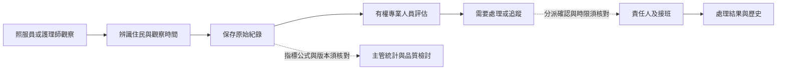
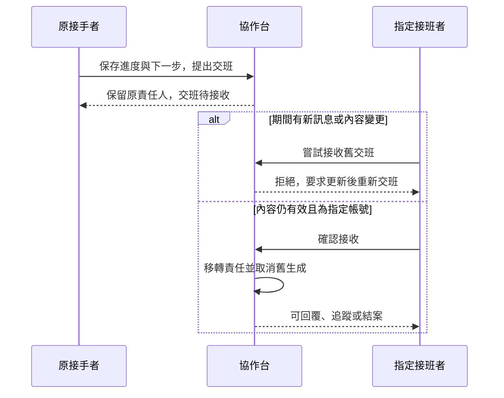
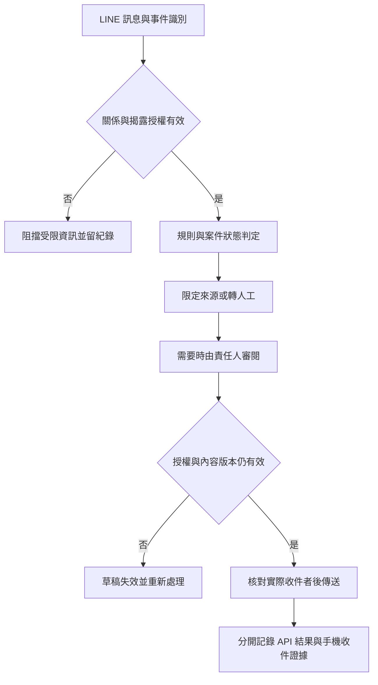

# 工作流程與責任比較

查閱：2026-10-24；基準：2026-10-23。此文件把「誰操作、在哪裡、填什麼、系統做什麼、誰確認、如何追蹤」放在同一條鏈。產品操作未公開的部分保留未知；流程圖均為研究者重建示意，不是原廠手冊。

## 情境與比較單位

主要採住宿型護理之家情境；日照及居服的資料另行標明，避免因名稱相似而互換。例如居服打卡的簽退不等於護理師已接收交班；護理紀錄簽核也不等於家屬訊息可以對外送出。

| 流程物件 | 對象與責任 | 應分開的狀態 |
| --- | --- | --- |
| 照護觀察／量測 | 住民、記錄者、觀察時間及來源 | 已記錄、尚未評估、需追蹤、已更正 |
| 護理評估與計畫 | 專業人員及適用版本 | 草稿、評估、核准、措施、評值；各產品實際狀態待證 |
| 交班 | 原接手者、指定接班者、最新內容 | 已提出、待接收、已接收、過時／撤回 |
| 家屬訊息 | 聯絡人、住民關係、授權、實際收件者 | 待人工、已接手、回覆中、結果不明、已結案 |
| 主管指標 | 前線資料、規則版本、分子及分母 | 未填、已填、排除、更正、統計已更新 |

這些是研究者分析所採的物件分法，並未宣稱三家資料庫採相同模型。

## 護理師開班：六階段比較

| 產品 | 使用者／進入頁面 | 輸入或選擇 | 系統處理 | 確認／簽核 | 後續追蹤 |
| --- | --- | --- | --- | --- | --- |
| Jubo 住宿 | 護理師看個人化提示及交班 App | 日期、區域、住民、提醒分類 | 整理跨班紀錄、異常及到期名單 | 已讀、接班責任確認的精確流程未知 | 查多日交班及紀錄檢核 |
| CareOne 護家 | 有登入及護理模組；開班頁未知 | 住民與表單分類有歷史文字線索 | 紀錄及統計可確認，當班待辦未知 | 未公開 | 當班逾期及責任追蹤未確認 |
| uCare 住宿 | 官方圖有首頁、人數與異常事件 | 模組及住民／床位欄 | 顯示事件、待簽／逾時區；圖為舊示例 | 接班者與確認規則未公開 | 品質統計存在，班別責任未知 |
| HITLGLOBAL | 院內角色登入，住民看板與訊息待辦 | 已授權住民、聯絡人對話、交班給我 | 依案件風險及狀態排序，顯示來源與時間 | 人工案件由指定接班者確認才移轉 | 進度、下一步、待確認與歷史；本機功能 |

證據：[J07](SOURCES_AND_EVIDENCE.md#j07)、[J11](SOURCES_AND_EVIDENCE.md#j11)、[C01](SOURCES_AND_EVIDENCE.md#c01)、[C05](SOURCES_AND_EVIDENCE.md#c05)、[U01](SOURCES_AND_EVIDENCE.md#u01)、H 的 BOARD／HANDOFF 核對組。

## 護理紀錄、量測、評估及異常

| 操作主題 | Jubo | CareOne | uCare | HITLGLOBAL |
| --- | --- | --- | --- | --- |
| 新增紀錄 | J36 教學可選住民／區域、時間、快捷帶入、存檔、多人照會及列印 | 護理紀錄、語音及動態表單 | 電子專業表單、DITTO 及紀錄帶入 | 保存自由文字觀察及五項量測 |
| 修改與專業簽核 | 有修改、評值與簽核模組；文件適用未知 | 現版完整更正及簽核未知 | 現版更正及專業簽核未知 | 追加新來源碼更正；無完整護理文件簽核 |
| 量測與歷史 | 相容設備上傳，VitalLink 可暫存；日照家屬圖有歷史曲線 | 生理服務與體重曲線；護家自動回填未確認 | 量測整合宣告；完整護理端趨勢未知 | 來源、觀察／入庫時間、缺值與紀錄列表，沒有趨勢圖 |
| 入住及定期評估 | 評估、計畫及到期頻率；全套入住流程未公開 | 護家完整評估流程未知，日照另有定期評估 | U17 日照定期評估表含週期／未評估；住宿入住細節未知 | 狀態回報不能當臨床量表 |
| 問題—計畫—措施—評值 | 有計畫與評值元件，完整關聯待查 | 計畫與舊 NANDA 授權；現版資料鏈待查 | 專業評估與服務計畫；護理鏈待查 | 沒有完整模組 |
| 跌倒／壓傷／感染 | 事件及傷口通知；壓傷分級、感染細節未知 | 歷史指標線索，現版事件流程不足 | 異常區及品質統計；特定事件流程未知 | 沒有專屬事件資料模型 |
| 傷口／管路／給藥／處置 | 傷口管路處置明示；逐次給藥核對未知 | 藥物處方明示；給藥為舊簡報線索 | 藥品入口與居護醫令；逐次給藥未知 | 沒有專屬臨床模組 |
| 跨專業照會 | 共享醫囑、營養、社工；照會閉環未知 | 各專業模組，照會閉環未知 | 跨專業資料整合，照會閉環未知 | 共用觀察與訊息，無臨床照會 |
| 逾期與行動 | 檢核、到期與行動交班；離線僅限已證明範圍 | 平日待辦、護理行動版與離線未知 | 舊圖有逾時表單；居服離線打卡不代表護理全離線 | 訊息等候時間；網頁，不是全套離線照護 App |

此表的逐項來源與狀態均展開於矩陣 N01～N30；各家詳細六階段操作見三份深度文件。沒有將表單選單視為每個臨床工作均已完整驗證。

## 照服員：任務執行與護理師資訊交換

| 產品／場域 | 使用者 → 頁面 → 輸入 | 系統處理 → 確認 → 追蹤 | 權限界線 |
| --- | --- | --- | --- |
| Jubo 日照／居服 | 日照總表勾選服務；Hi App 查班、簽到退、回報特殊狀況 | 資料回到總覽與核銷檢查；例外核准順序未知 | 角色可設定；照服員能否更正、評估及查全部住民未公開 |
| CareOne 居服／護家 | 居服有查班、打卡與簽名；護家照服員當日工作台未公開 | 模組可保存服務，護理師接收通知與回覆未知 | 職務／住民群組已宣告，逐欄權限未知 |
| uCare 居服 | 看當日訪視 → 簽到 → 勾選服務項目與時間 → 簽退 | 回到單位管理端供核定／核銷，補簽另申請 | App 為既有客戶使用；住宿照服員角色與可見範圍未知 |
| HITLGLOBAL | 查看已授權住民 → 新增觀察、時間及數值 | 保存來源；看板顯示；護理師可依原紀錄評估 | 後端拒絕照服員設定已評估狀態；較新未評估資料不清掉先前追蹤 |

證據：J20、J27、J30、C01、C02、U13、U14；H 的 OBS／AUTH。三家的居服執行證據有助了解服務紀錄設計，無法直接補出住宿照服員的官方權限。

## 護理長：從前線資料到品質管理

| 階段 | Jubo | CareOne | uCare | HITLGLOBAL |
| --- | --- | --- | --- | --- |
| 接收資料 | 照護紀錄、量測、事件與評估 | 護理、醫藥、營養及人員表單 | 跨專業表單、量測與執行紀錄 | 觀察、來源與人工服務案件 |
| 查漏與分派 | 提醒、頻率、檢核與主管簽核 | 評鑑彙整預評；平日任務分派未知 | 舊首頁表單區，分派時序未知 | 訊息待辦可接手／交班；不是臨床工作派工 |
| 統計 | 宣告自動臨床串接與品質指標 | 有統計及歷史品質報表；現版自動串接未知 | 宣告跨表單與品質指標自動統計 | 待辦及追蹤數量，無臨床品質公式 |
| 檢討與改善 | 收案、改善片語及照片 | 完整現版改善流程未知 | 評鑑及報表；改善流程未公開 | 人工案件可寫進度與結案，非機構品質管理 |
| 回查 | 紀錄、圖表及簽核時間；完整重算規格未知 | 報表與預評，追溯規則未知 | 表單連動及稽核；完整分母／版本未知 | 本機案件／觀察／操作者與時間可查 |

來源：J08～J10、C01／C02／C05、U00／U11、H 的 BOARD／AUDIT。各家的「九大」或「六大」品質指標名稱與年度不同，不是可直接比較的功能總數，也不能取代 G04／G05 全部評鑑要求。

## 管理者：入住、人員、成本及行政

三家均公開了不同深度的住民、人事或財會管理。Jubo 與 uCare 對前線到後台的整合描述較具體；CareOne 明列模組，但資料流細節較少。HITLGLOBAL 只有既有住民、轉床、授權及備份，尚不足以取代入退住、人資、薪資、耗材、營養或會計系統。

主管工作應逐項核對入住／退住、床位、人員與權限、排班出勤、工作負荷、完成率、逾期、教育證照、品質、事件、成本、財務及評鑑；對應矩陣 S01～S25。每個未確認格都保留於 [PUBLIC_GAPS.csv](PUBLIC_GAPS.csv)，沒有因為「有 ERP」而全部填支援。

## 家屬與 LINE 獨立比較

| 階段 | Jubo 安心寶 2.0（日照） | CareOne | uCare（日照） | HITLGLOBAL |
| --- | --- | --- | --- | --- |
| 關係及入口 | 官方帳號串接、家屬重新驗證及服務對象綁定 | 未確認 | 家屬聯絡簿 App；綁定細節未知 | 本機模擬關係；真實 LINE 待做 |
| 查詢 | 健康、活動、接送、帳單、聯絡簿 | 未確認 | 日間照顧資料，精確欄位未知 | 家屬不登入院內網頁，對外查詢待做 |
| 訊息與通知 | 官方帳號、留言回覆與推播 | 未確認 | App 存在不證明全部通知／聊天能力 | 人工回覆及模擬傳輸，不是手機已收到 |
| AI | 聯絡簿文字生成有證據 | 未確認 | 家屬 AI 自動回覆未確認 | 受限服務生成核心，尚無正式家屬照護問答驗收 |
| 人工接手 | 與 H 相同案件狀態機未公開 | 未確認 | 未確認 | 接手、進度、交班及結案本機已測 |
| 多家屬及撤銷 | 精確隔離、範圍及生效時序未知 | 未確認 | 未確認 | 同住民各聯絡人隔離與撤銷阻擋本機已測 |
| 歷史 | 聯絡簿回覆與歷史明示 | 未確認 | 內容與保存規格未知 | 院內依權限保留對話及舊版歷史 |

來源：J13／J18、C01、U01／U11、H CONTACT／REVOKE／CASE／HANDOFF。uCare 的廠商客服 Line 群、其他托育產品即時聊天，以及 TLCA 家屬 App，均未放入 uCare 家屬 LINE 能力。

## 研究者重建示意：前線紀錄到主管

此圖是跨產品研究用模型；虛線項目需要個別產品補證，不能當三家都已提供。

## 研究者重建示意：HITLGLOBAL 已測交班語意

依本輪固定程式及既有測試重建。這是服務案件交班，並非完整臨床護理交班。

## 研究者重建示意：家屬訊息治理目標

以下是 HITLGLOBAL 試點建議，實線表示建議驗收的必要順序，不代表現版真實 LINE 已完成。

## 哪些便利性目前不能下結論

本輪沒有同一位護理師、同一批住民資料與相同任務的跨產品計時，也沒有點擊次數、重複欄位、錯誤率或訓練後表現的可比資料。可觀察的勾選、帶入、語音或 App 只能支持設計機制存在。真正的便利性比較應讓相同使用角色完成同題工作，記錄來源、更正、交班及失敗情境，而不替行銷文字打分。

[返回入口](README.md) · [UI 目錄](UI_REFERENCE_CATALOG.md) · [技術與資安](TECHNOLOGY_AND_SECURITY.md) · [試點策略](PRODUCT_STRATEGY.md)
