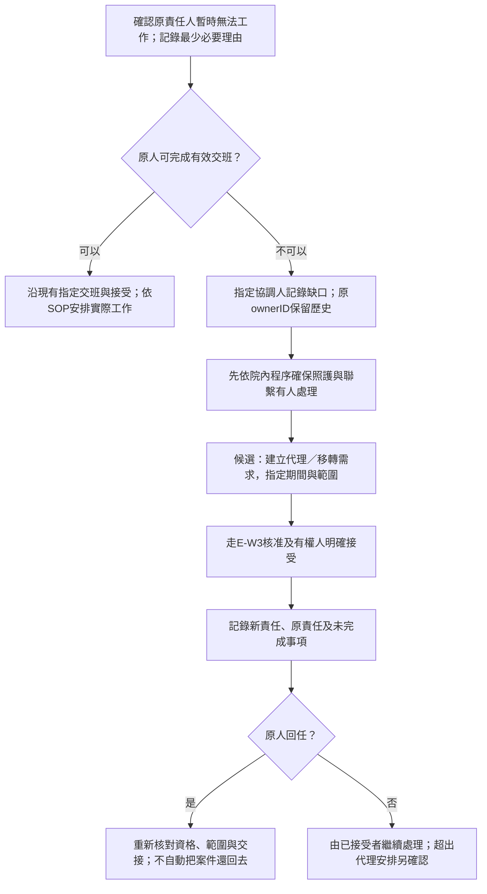
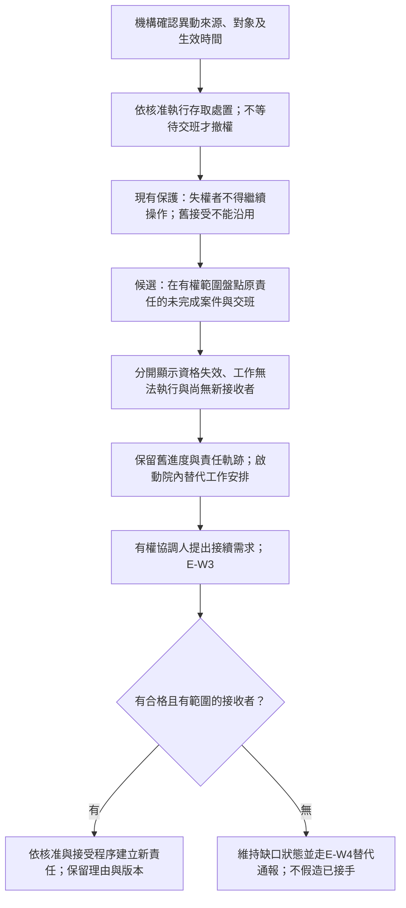
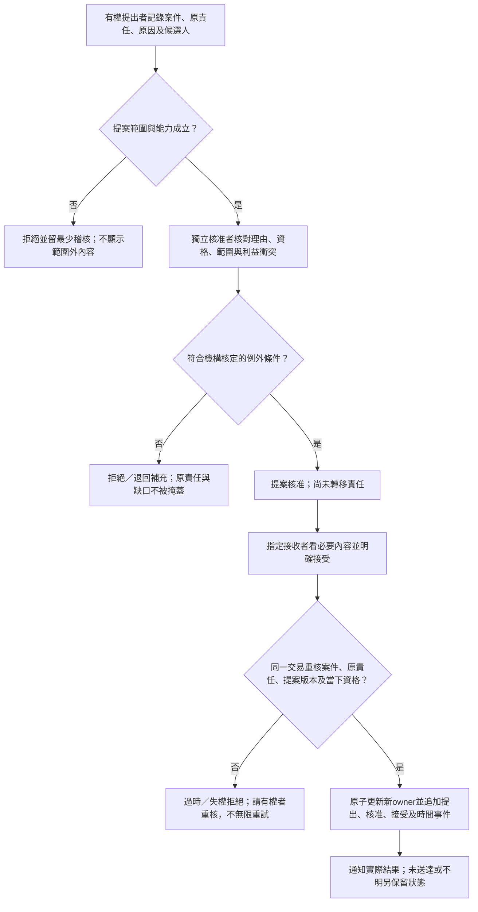
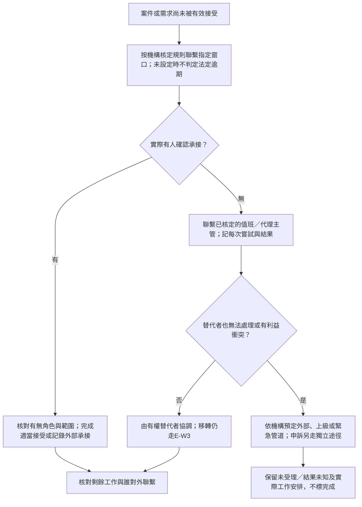

# 責任缺口、代理與改派設計

本文件全為D＋S候選規格，沒有新增自動改派、停權、代理或主管寫入能力。現有R只保留責任ID、授權重驗、指定接受與監控；缺口可能仍需院內電話、紙本或原ERP處理。H0～H3見 [角色矩陣](ROLE_AND_PERMISSION_MATRIX.md)。

## 分開處理三種代理

1. 案件接續：某件服務工作由哪個有權帳號接受；須保留原責任、內容與版本。
2. 班務／工作代理：臨時不能工作時由機構安排實際人力；人力安排不自動授予住民資料權。
3. 法定職務代理：若不能執行的是L01所指負責護理人員職務，另核對第19-1條、資格及報備。不能用點選「接受案件」代替法定安排，也不能把其期限套到普通交班。

## 情境與初步處置

| ID／情境 | 權限與責任如何判斷 | D候選處置 | 仍需取得的SOP／證據 |
| --- | --- | --- | --- |
| E01 臨時請假／突然無法工作 | 不能工作與資格失效不同；原ID留存，不分享帳密。 | 已知交接可請原人提出；無法提出則由指定協調人建立缺口需求，走獨立核准及有權接收。 | S04、S08：當班替代名單、誰確認無法工作、原人不能操作時的例外。 |
| E02 離職 | 人事生效、業務交接及存取撤銷分開；離職後不保留為了接班而開的權限。 | 先安排可行交接；到生效時撤權，即使尚未接受也不能拖延。原責任失效案件進缺口處理。 | S14：生效來源、撤權執行者、未交接案件的承接人。 |
| E03 停權／失去住民授權 | 停止未來操作；保留歷史ID、查明影響範圍。 | 取消或失效過時提案，列出無有效責任案件；不能讓失權原人完成確認後才撤權。 | S14／S15：停權與暫時限制的核定、現有工作階段／匯出殘留處理。 |
| E04 指定接班者未接受 | 通知、已讀與接受不同；原責任若仍有效即保留。 | 依機構規則聯繫、重提或取消；原人也不能工作時轉E01或E05。 | S05：何時啟動替代聯繫、假日與未設定目標如何處理。 |
| E05 護理長看到無有效責任人 | 唯讀發現缺口，不表示自己已接手。 | H0走院內通報；H1才可能新增需求；所有改派另走E-W3。 | S06～S09：何人可提、何人核准、誰保證現場工作不中斷。 |
| E06 主管／核准人不能處理 | 換聯繫窗口不代表換案件owner。 | 找事先核定且無利衝突的替代者；無人可處理依機構外部／值班程序，不宣稱已完成。 | S13：夜間、假日、負責人被申訴或多重缺勤時的替代順序。 |
| E07 接收中有新訊息、撤權或另一人先接受 | 舊畫面及核准不賦予寫入權。 | 最終交易重核；拒絕過時接受，重新確認，保留失敗事件。 | S09／S15：如何向原與新接收人顯示衝突，誰確認新內容。 |
| E08 系統或通訊故障 | 沒有回執就結果未知；實際照護不能等修復。 | 依既有離線替代程序承接；恢復後核對實際責任、補記來源與避免重複送出。 | S18：電話／紙本承接、復原核對、紀錄時間與操作者。 |

## E-W1：臨時無法工作與代理

原人即使仍有系統資格，也可能無法實際工作；「owner_valid」不得被當成出勤或照護覆蓋的證明。暫時代理是否轉移案件責任、只代處理哪個子事項、由誰對外聯繫，須在選方案時明訂，不使用模糊的「代為處理」按鈕。

系統保留原ownerID是追蹤記錄，不表示要求已請假、離職或無法工作的原人繼續執行照護，也不能替代機構安排實際接續。若現場已有人承接而軟體仍停在舊狀態，須依核定程序補核對與留痕；不能把兩種狀態默認成一致。

## E-W2：離職、停權、撤權與無有效責任人

現有監控可識別原責任帳號的角色／住民權限失效，不具正式停權或全院異動盤點。不得把一次UI標記當成員工生命週期管理已完成。也不得刪除或重用離職帳號ID，造成歷史責任換人。

## E-W3：受控提案、核准與接受

此圖全為候選，沒有新增實際API。原人仍有權時可考慮沿既有交班；原人已失效時，必須有經SOP確認的例外核准依據。多一個核准畫面本身不會使原本無資格的人有資格接手。

## E-W4：未接收、主管不能處理與替代通報

替代通報表須填角色、可用時段、聯絡方式的保管位置、何人維護與失敗後下一步。訪談版留空，不寫入真實電話或私人LINE。法定負責護理人員無法執行職務時，另核對L01法定代理；不得只把需求丟給「最高主管」而停止追蹤。

## 候選狀態模型與資料

case.status沿用pending／claimed／closed；下列是未實作的協作維度，不改變HITL人工狀態。

| 維度 | 候選值 | 不可推定的事 |
| --- | --- | --- |
| responsibility_validity | valid／invalid／unconfirmed | valid不代表正在上班；invalid不清掉歷史責任。 |
| availability | available／temporarily_unavailable／unknown | 不由登入時間自動判定出勤，也不把請假理由廣播。 |
| request_state | proposed／needs_information／approved／rejected／withdrawn／expired／superseded／accepted | approved、sent、read均不等於accepted；expired規則須另有機構依據。 |
| contact_result | not_attempted／attempted／confirmed／failed／unknown | 平台接受不等於手機已收到，更不等於接手。 |

最少欄位：request_id、case_id、resident_id、domain、原owner_id、建議receiver_id、reason_code與受限理由、提出／核准／接受者各自ID、機構授權依據代碼、版本與時間、結果、失敗原因及外部承接引用。顯示名稱只作標籤；不能讓呼叫者任填actor。臨床原文不放入IT可見核准單或技術log。

每次核准與接受都重驗目前資格、資料範圍、案件未結束、原責任、提案內容及版本。進度或新訊息有變時重新確認；核准後撤權立即阻擋舊接受。兩人同時接受只能有一個成功；重送以穩定請求ID識別，不能產生第二次責任轉移。正式不可竄改稽核與跨程序一致性未完成，不能由本規格存在就聲稱可保證。

## 必須先比較的方案

| 問題 | 方案一D | 方案二D | 驗證方式與暫定預設 |
| --- | --- | --- | --- |
| 原人暫時不能工作 | 轉移整件案件，恢復時另交回。 | 保留責任，另建有範圍的代理子事項。 | U09請兩位人員各自指出誰對結果負責；未確認前不實作任一方案。 |
| 原人已失權 | 獨立核准＋有權接收，保留原責任歷史。 | 先由院內既有制度處理，系統只讀記錄缺口。 | U10～U12；沒有可用核准／接受人時選只讀與替代程序，不放寬權限。 |
| 夜間核准人不在 | 事先核定輪值替代者。 | 沿院內離線程序，次班核對記錄。 | U14／U19核對實際可達性與照護安排，不把事後補記當成事前已核准。 |
| 交班未接受 | 保留原責任並人工聯繫。 | 有經機構確認的提醒，失敗仍有人負責。 | U13；未知時限不自造倒數或法定逾期。 |

下一輪應先確認「誰能在原責任人不能操作時合法完成接續」及「中間時間如何保障實際工作」，再討論介面。不能為了讓看板變綠而把案件自動塞給護理長或IT。
