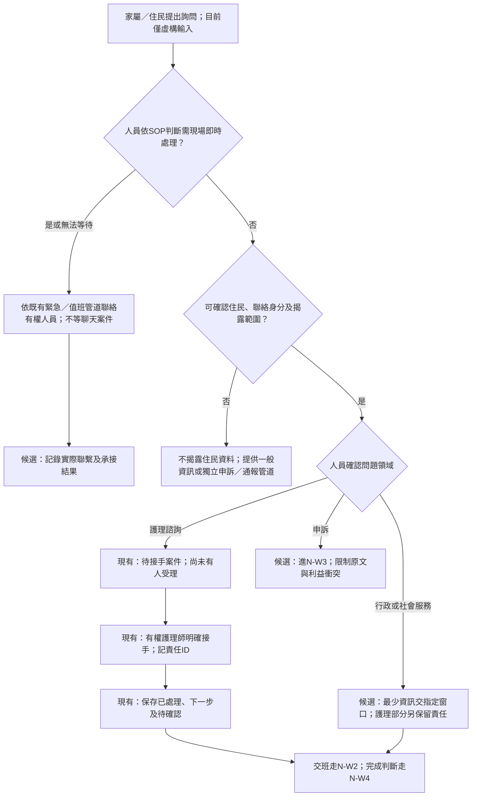
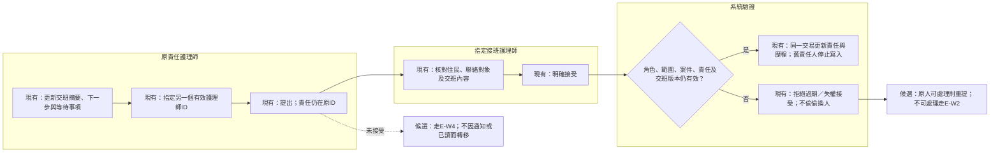
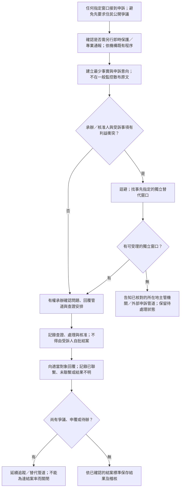
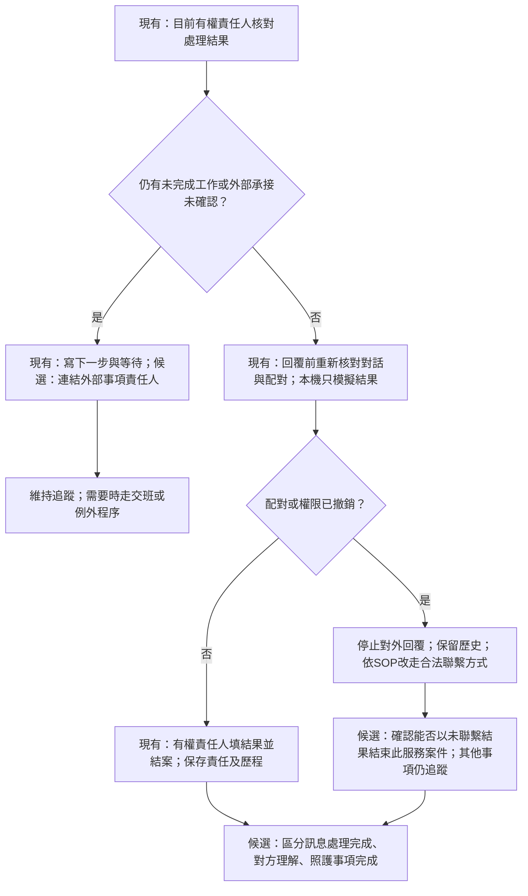

# 機構詢問、交接與結案流程

本文件為 D＋S 可驗證的流程設計。標「現有」的節點只表示固定程式有對應本機功能；標「候選」的分流、申訴及跨專業程序尚未實作。家屬入口仍為模擬，沒有真實LINE。法規與產品來源見 [SOURCES](SOURCES.md)，職務及資料界線見 [角色矩陣](ROLE_AND_PERMISSION_MATRIX.md)。

## 工作物件與責任

| 物件 | 最少需辨認的內容 | 與其他物件的區別 |
| --- | --- | --- |
| 住民與聯絡關係 | 住民ID、單一聯絡人、可揭露範圍、有效性。 | 家屬關係不是所有資料的授權，床號也不是住民ID。 |
| 家屬服務案件 | 對話、原因、案件狀態、目前責任ID、下一步。 | 不是完整病歷；同住民不同聯絡人各自隔離。 |
| 照護觀察／專業紀錄 | 觀察者、時間、來源、專業評估或既有紀錄系統引用。 | 一般訊息摘要不能替代依法或依專業應製作的紀錄。 |
| 交班需求 | 原責任、指定接受者、已做／下一步／等待、版本。 | 提出、被通知、看過及接受是四件不同的事。 |
| 服務協調子事項 | 行政／社工需做的事項、最少資訊、回報窗口。 | 現有程式未有社工／行政案件角色，先用情境卡驗證分流。 |
| 申訴專案 | 獨立承辦、受訴人、迴避、必要事實與回覆結果。 | 不直接將全部申訴文字寫入一般護理監控或給被申訴人看。 |
| 責任變更提案 | 理由、原／新責任、提出／核准／接受的各自ID。 | 與帳號啟停、法定職務代理及臨床照護指示分開。 |

日常工作建議由當班人員核對待接手、自己處理、待接受交班及照護回報；護理長核對未接手與責任待確認的缺口。這是訪談起點，並非已查證每家機構均採相同順序。先問現行紙本、電話、ERP及LINE的交接點，再決定是否新增系統操作。

## N-W1：家屬詢問、分流與人工接手

L01的危急處理義務只作專業界線來源；圖中的判斷與院內聯絡方式由機構確認。本系統的訊息風險等級不等於醫療急迫分級，沒有新設醫療閾值或由模型判定緊急程度。未能驗證聯絡人時仍可接收一般反映／申訴線索；停止的是受限資料揭露，不能因此阻斷需要現場協助的通報。

若詢問同時有帳務、社會支持與護理問題，D候選為拆成可追蹤子事項，記錄各窗口及回報；不把全部護理紀錄轉送行政。正式誰是對外整合窗口、誰確認回覆完整，由 S03／S04決定。現有護理案件不能直接交給尚未有角色的社工帳號。

## N-W2：跨班交班與指定接受

目前R02會在保存新進度時使舊交班失效，接受時也檢查最新訊息及原責任人的資格。新訊息、被取消、撤權與已被他人接受可能回不同錯誤；操作上均須重新核對，不能盲目重送。交班成立也不表示所有照護事項已完成；接班者要能說出下一步與未確認事項。

班表是找候選人的資訊，不直接取得責任。臨時缺勤、無接班人、班表與授權矛盾及多人同時接受的設計見 [例外處理](CASE_ESCALATION_DESIGN.md)。現有系統未自動通知或追蹤未接收時限，訪談不能將15分鐘游標期限當成接班期限。

## N-W3：申訴、迴避及獨立承辦

全圖為D＋S，尚未有獨立申訴端點、角色或保密投影。

不預設護理長就是所有申訴的承辦或核准者。申訴對象若是負責人，內部無獨立窗口時須有可用外部管道。所在地的正式申訴方式、契約與回覆期限需由機構核對；本輪沒有創造全國一致的申訴回覆天數。未取得申訴者同意的內部分享與最少查證資料如何取得，列 S11／S12。

若現有介面只提供一般護理案件，訪談使用紙本申訴卡；不實際把敏感人事指控寫入一般家屬對話作為「原型」。保護申訴者與被申訴人的權益，保留事實待確認及申覆途徑，不以軟體標籤判定責任。

## N-W4：回覆、未完成事項與結案

現有程式的結案要求責任人及結果文字，不會自動檢查所有外部待辦。圖中的完整結案檢核是候選需求。機構可選「保留原案件至完成」或「有已接受的外部事項且交叉連結後結束訊息案件」；兩者都不能把未確認承接當完成。參與者以 U05／U18比較，保留機構選擇與反例。

回覆已送出、本機記錄成功、通訊平台接受、家屬手機收件與已讀必須分開；目前沒有真實平台結果。家屬未讀不自動代表案件不能結束，也不自動代表可以結束，需核對案件目的及SOP。申訴結案另走N-W3；完整臨床紀錄、照護計畫與品質指標由原專業制度負責。

## 三家公開工作物件與HITLGLOBAL差距

P來源是廠商自述；「研究者重建」只表示可從公開模組提出的待驗證工作鏈，未證明廠商實際按該順序操作。沒有公開接受、權限或API資料時，記未知。

| 產品／證據 | 公開可確認的工作物件P | 研究者重建D及適用範圍 | 本輪不能確認 | HITLGLOBAL需補足或訪談的事 |
| --- | --- | --- | --- | --- |
| Jubo，P01／P02 | 照護紀錄、交班、家屬溝通，另有摘要工具。 | 從照護資訊整理出交班與溝通素材；住宿方案與其他場域分開看。 | 摘要後的核准／送出時序、家屬可見欄位、責任接受與強制改派。 | 減少重複整理、來源引用與人員確認；不把摘要當接手或醫療判斷。 |
| CareOne，P03 | 護理之家段落的住民入出、護理紀錄／計畫、人員及行政模組。 | 入住與住民管理→專業照護紀錄→人員／行政追蹤，是模組推論，非官方完整時序。 | 家屬詢問如何派給誰、跨班明確接受、申訴迴避、職務代理的產品規則。 | 補行政／社工的最少事項交接與原系統連結；不重做其整套ERP或假定有可用API。 |
| uCare，P04 | 機構跨專業電子紀錄與行程白板。 | 團隊記錄→照護資訊彙整→日常行程呈現，是公開物件的D重建。 | 護理之家家屬入口、責任狀態、接收確認、社工或行政的精確權限。 | 把下一步與待確認事項接到可辨識責任；家屬對話隔離不能靠共享白板取代。 |
| HITLGLOBAL，R01～R04 | 授權對話、人工接手、指定接受、進度、唯讀監控。 | 目前本機流程已可操作；與法定護理紀錄不同。 | 機構實際分流、正式員工生命週期、代理、申訴與改派。 | 優先用本包驗證責任缺口與資訊負擔，再決定下一個功能。 |

## 下一輪設計問題

| 差距ID | 可驗證假設D | 低成本替代驗證 | 影響的決策 |
| --- | --- | --- | --- |
| G01 跨專業分流 | 行政與社工只需要被分派的少量事項，不需要整段護理原文。 | U16以遮蔽欄位卡讓人員說明少了什麼；記錄必需欄位及理由。 | 是否建立獨立服務領域角色，或先維持院內轉介。 |
| G02 交班與未接收 | 清楚分開提出與接受，可以減少責任誤認。 | U02～U04／U13請當班與接班者各自說出「現在誰負責」。 | 接受提示、監控與提醒需求。 |
| G03 人員生命週期 | 失權與不能工作需要不同狀態及替代程序。 | U09～U12比較暫時代理與資格失效，不把請假一律當停權。 | 先做只讀異常旗標或需完整改派。 |
| G04 申訴與保密 | 一般監控不適合承載全部申訴原文。 | U15用受訴人角色卡比較可見資訊；核對獨立窗口。 | 另建受限流程或先用既有院內申訴制度。 |
| G05 重工與來源 | 進度表單可能與既有ERP重複。 | 觀察U01／U05需要重填哪些內容，以欄位名稱記錄，不索取真實畫面或資料。 | 連結原系統、最少紀錄或合法介接的取捨。 |
| G06 管理指標 | 訊息結案速度不足以描述照護品質。 | U18比較尚有照護待辦卻已回覆的案例，請主管決定何時可結案。 | 結案條件與指標名稱，不自訂臨床成效。 |

詳細優先序及暫不開發項目見 [NEXT_MVP_DECISION](NEXT_MVP_DECISION.md)。沒有用公開資料不足作為競品缺陷，也不把本輪設計當成產品優於競品的成效證據。
