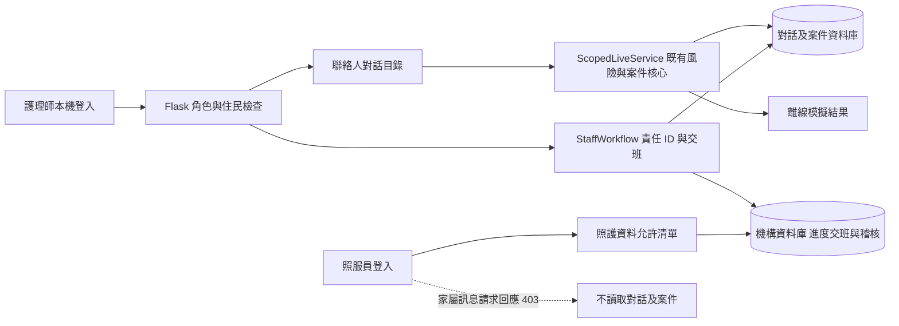
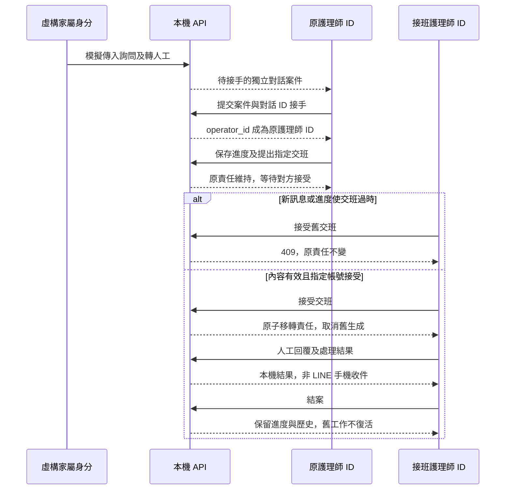

# 資料流與 API 契約

2026-10-25，MVP 0.1。本頁以本輪修正後的本機應用為準；未實作的新監控端點另列，不混入現行 [OpenAPI 契約](openapi.json)。正式身分、LINE、ERP 及多機構服務均未開通。

## 資料物件與權責

| 物件／資料來源 | 唯一識別與語意 | 本輪界線 |
| --- | --- | --- |
| 院內使用者 | users.id 是穩定責任 ID；名稱是標籤 | 個人生命週期、停權及 ID 不重用制度仍待正式化 |
| 住民／床位 | resident.id 與 bed_id 分開 | 轉床不改住民、授權及對話 |
| 聯絡人關係 | contact_id＋resident_id、有效授權與模擬連結 | 配對不讓所有聯絡人共用歷史；沒有真實 LINE 身分 |
| 對話 | 不透明 conversation_id 綁定住民與單一聯絡人 | 不當成真實 LINE 收件者；舊混合歷史為院內紀錄 |
| 訊息／事件 | event_id、message.id、來源、作者與時間 | 本機模擬事件；真實 Webhook 去重未實作 |
| 案件 | case.id、對話、status、operator_id、觸發原因與時間 | 人工案件與生成狀態分開 |
| 進度／交班 | case_id、revision、from_user／to_user、提出時的 message_id | 保存進度或新訊息會使既有交班不可直接沿用 |
| 生成 | generation.id、事件、來源、設定／提示／知識版本與狀態 | 本輪模型停用；不以案例展示證明 AI 逐句品質 |
| 觀察／評估 | resident_id、來源紀錄碼、觀察／入庫時間、記錄者及狀態 | 與家屬對話分開；照服員不能設定專業評估 |
| 稽核／遷移 | 操作人 ID、事件、時間、原身分與映射判定 | 本機 SQLite，未有不可竄改封存 |

## 研究者依程式重建：本機資料流



## 研究者重建：一件家屬詢問



## 現行 API：登入與共同控制

所有端點只供 localhost，拒絕外部 Host／來源 IP。院內工作階段存放 `uid`；每次請求重新讀取帳號角色及住民權限。POST 另驗證同源與 `X-CSRF-Token`，JSON 必須為物件。這不是正式遠端身分服務。

| 路徑 | 請求／回應要點 | 允許角色 |
| --- | --- | --- |
| GET /api/session | user、csrf、院內 roles、環境標記；失效角色清除工作階段 | 未登入可取初始化資料 |
| POST /api/login | username、password；成功後回 user 與新的 csrf | 只有院內角色可登入 |
| POST /api/logout | 清除工作階段；畫面同步清空受限內容 | 本機工作階段 |
| GET /api/board | cards、work_queue、同步時間、模式、目前使用者 | 院內；照服員 queue 空且卡片無案件欄位 |
| GET /api/knowledge | 公開來源摘要及正式機構資料尚未提供的標記 | 院內；不包含家屬訊息 |
| GET／POST /api/bindings | 讀取／調整模擬工作範圍或關係；POST user_id、resident_id、allowed | admin 體驗角色 |

不得把回應中的 `line_link` 或邏輯對話碼當成實際 LINE 身分。正式外部入口需另設事件驗證、收件者映射及撤銷傳播，本輪沒有開放此入口。

## 現行 API：住民與對話

`GET /api/residents/{rid}` 對照服員回應只有：

```json
{"resident":{"id":"R001","label":"示範住民 01","bed_id":"A101","ward":"A 區"},"observations":[],"role":"caregiver"}
```

這是空觀察的格式示例；真實本機示範有虛構紀錄。帶任何 `conversation_id` 查詢時，照服員回應 403，即使住民在工作範圍內也一樣。

護理師／admin 可附 `conversation_id`，取得 conversations、selected_conversation、messages、case、state、drafts、workflow、line_contacts 與 audit。沒有指定對話時，現有向後相容行為選院內舊紀錄；MVP 用戶端應明確帶選定的對話。

| 關鍵欄位 | 型態／語意 |
| --- | --- |
| selected_conversation | id、kind、contact_id、label、active、recipient；recipient 仍只是模擬資料 |
| case | 無未結案案件為 null；否則 id、status、trigger_risk、origin、created_at、operator_id、operator_name |
| case.operator_id | string 或 null；真正的責任依據，不能由請求自由指定 |
| case.operator_name／operator | 可重複、可更名的呈現文字；operator 為相容別名 |
| workflow.note | summary、next_action、waiting_for、revision、updated_by、updated_at、updated_name；未保存為 null |
| workflow.handoff | 指定的 from_user、to_user、提出時 message_id、status、stale 與時間；沒有為 null |
| workflow.context | 原因、相關分級、近期訊息、固定服務摘要、等待／持續時間 |
| workflow.history | 目前對話最近 5 件結案，含責任 ID、結果及進度；不是跨期間完整報表 |
| messages | text、actor、source、delivery、時間與輸入身分等既有欄位；只有有權角色取得 |

`POST /api/residents/{rid}/message` 僅護理師／admin 使用：text 1～2000 字、channel=web 或 demo_line；後者必須有已配對的 line_actor，若帶 conversation_id 必須與來源一致。成功回傳 result、conversation_id、actual_line_sent=false。照服員兩種通道都為 403。

`POST /api/residents/{rid}/observation` 可由院內人員於允許住民回報。observed_at 需含時區；數值可缺省，care_note 最多 2000 字。照服員僅能 care_status=尚未評估；評估／追蹤狀態及原因沿用既有控制。

## 現行 API：案件操作

統一 `POST /api/residents/{rid}/case/{action}`。所有操作先驗證角色、住民、對話及目前案件；請求帶整數 case_id。現有舊紀錄相容模式可省略 conversation_id，家屬流程用戶端一律帶明確對話。操作者取目前工作階段，不採用請求中額外的身分欄位。

```json
{"case_id":1,"conversation_id":"care-contact-示例識別碼","summary":"虛構已處理內容","next_action":"由接班者確認後回覆","waiting_for":"等待確認","revision":0}
```

| action | 額外資料 | 寫入前條件與結果 |
| --- | --- | --- |
| claim | 無 | 待接手；成功才寫責任 ID，取消自動生成 |
| progress | summary 1～1000、next_action 1～1000、waiting_for 0～500、revision 非負整數 | 目前責任 ID，版本一致；revision 加一並取消舊待接收交班 |
| handoff | progress 全部欄位＋to_user | 目前責任 ID；另一位有效護理／管理帳號；提出後原責任不變 |
| accept_handoff | request_id 整數 | 指定接班 ID、原責任 ID、對話及訊息版本一致；移轉並取消舊生成 |
| cancel_handoff | 無 | 目前責任 ID；取消待接收交班 |
| reply | text 1～2000 | 目前責任 ID、關係有效；只產生本機回覆，案件持續 |
| resolve | note 1～1000 | 目前責任 ID；保留結案及歷史，取消舊交班與生成；不恢復撤銷配對 |
| approve | job_id 整數、text 1～2000、note 1～1000 | 目前責任、同對話草稿、關係與既有生成有效性控制；本輪未做線上模型正向驗收 |
| reject | job_id 整數、note 1～1000 | 目前責任及同對話草稿；保留退回紀錄 |

成功為 200 `{"ok":true}`。寫入成功後重新讀取詳細資料與看板；不要用舊畫面自行推定移轉或送出成功。API 請求傳入同名標籤不能改變責任。

| 回應 | 使用者處理 |
| --- | --- |
| 400 | 欄位／對話來源格式錯誤、沒有可處理案件或草稿已無效等；保留輸入後確認 |
| 401 | 未登入或院內工作階段失效；重新登入 |
| 403 | 角色、住民、對話、責任或收件授權不符；不能改用其他身分重試 |
| 409 | case_id 已變、進度版本過時、交班過時或責任已變；更新後由有權人員確認 |
| 500／連線失敗 | 操作結果需核對；不盲目重送回覆，不顯示手機已收件 |

## 待實作：主管監控契約

以下端點目前不存在。它們是第一版設計輸入，不能由 OpenAPI 的現行端點測試結果推論已完成。

| 候選端點 | 請求 | 回應與控制 |
| --- | --- | --- |
| GET /api/case-monitor | status、owner_id、handoff_to、risk、from、to、cursor、limit | 具有 case.monitor 的臨床主管及授權範圍；摘要、統計、updated_at、next_cursor，預設不含完整家屬原文 |
| GET /api/case-monitor/{case_id}/timeline | 目前查看的案件 | 核對住民／機構權限後回事件、責任 ID、來源及版本；不能僅憑全域 case_id 讀取 |
| POST /api/cases/{case_id}/deadline | due_at、reason、revision | 有權臨床主管設定，保存舊值與操作者；不推定醫療處置期限 |
| POST /api/cases/{case_id}/escalation | reason、target、revision | 設計待機構確認；通知不是接受，原責任持續；不能直接等同改派 |

統計定義：pending／claimed 按案件；pending handoff 與 claimed 可重疊；逾期只計明確設定 due_at 且未結案者；未知時限獨立列出。查詢期間、時區及分母必須隨結果回傳。實作前先完成正式臨床主管／IT 能力分離及分頁範圍控制。

待實作資料欄位：due_at、last_action_at 的明確更新規則、機構範圍、升級／代理、通知結果。不得以現有 `elapsed_seconds` 直接替代逾期；該欄只是建立以來經過時間。

[頁面規格](PAGE_SPEC.md) · [驗收](ACCEPTANCE.md) · [安全與遷移](SECURITY_AND_MIGRATION.md)
